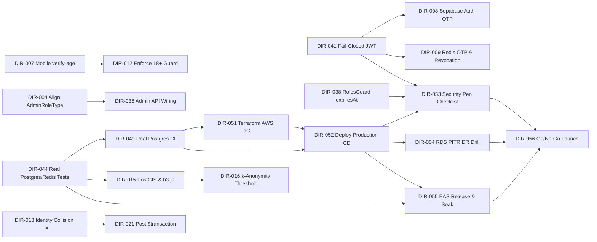

# diriddle — Product Backlog (`DIR-001` – `DIR-058`)

> **Planning Model**: Solo developer executing 6 × 2-week sprints (12 weeks).  
> **Committed MVP Scope**: `30` issues = `86` story points (`14–15` pts/sprint).  
> **Post-Selection Backlog**: `28` issues = `102` story points (`Release 1.0 – MVP` fast-follow / deferred).

---

## Sprint & Milestone Allocation Summary

| Sprint | Weeks | Target Milestone | Issue IDs | Total Pts |
|---|---|---|---|---|
| **Sprint 1** | W1–W2 | `Release 0.1 – Engineering Alpha` | `DIR-001`, `DIR-003`, `DIR-004`, `DIR-007`, `DIR-030`, `DIR-038`, `DIR-041` | **14** |
| **Sprint 2** | W3–W4 | `Release 0.1 – Engineering Alpha` | `DIR-002`, `DIR-012`, `DIR-013`, `DIR-044` | **14** |
| **Sprint 3** | W5–W6 | `Release 0.2 – Feature Alpha` | `DIR-008`, `DIR-009`, `DIR-010`, `DIR-049` | **14** |
| **Sprint 4** | W7–W8 | `Release 0.2 – Feature Alpha` | `DIR-015`, `DIR-016`, `DIR-021`, `DIR-027`, `DIR-034` | **15** |
| **Sprint 5** | W9–W10 | `Release 0.3 – Safety Beta` | `DIR-011`, `DIR-033`, `DIR-036`, `DIR-037` | **14** |
| **Sprint 6** | W11–W12 | `Release 0.9 – Release Candidate` & `Release 1.0 – MVP` | `DIR-051`, `DIR-052`, `DIR-053` (RC: 10) + `DIR-054`, `DIR-055`, `DIR-056` (MVP: 5) | **15** |
| **Backlog** | Post-W12 | `Release 1.0 – MVP` (Backlog) | `DIR-005`, `DIR-006`, `DIR-014`, `DIR-017`..`DIR-020`, `DIR-022`..`DIR-026`, `DIR-028`, `DIR-029`, `DIR-031`, `DIR-032`, `DIR-035`, `DIR-039`, `DIR-040`, `DIR-042`, `DIR-043`, `DIR-045`..`DIR-048`, `DIR-050`, `DIR-057`, `DIR-058` | **102** |

---

## Dependency Map

---

## `DIR-EP01` — Project Foundation & Architecture

### `DIR-001` — Fix Prettier formatting across 126 files and enforce `format:check` in CI
- **Parent Epic**: `DIR-EP01`
- **Issue Type**: `Technical Debt`
- **Description**: `pnpm run format:check` fails (exit 1) on 126 files across the monorepo, and CI does not enforce formatting. Formatting all files and adding `format:check` prevents noisy diffs.
- **User Story**: As a solo developer, I want consistent Prettier formatting enforced in CI, so that code reviews and diffs stay clean.
- **Acceptance Criteria**:
  - **Given** the clean repository, **When** `pnpm run format:check` runs, **Then** it exits `0` with zero unformatted files.
  - **Given** a PR with unformatted TypeScript, **When** CI runs, **Then** the formatting check fails before merge.
- **Technical Tasks**:
  - [ ] Run `pnpm run format` across all workspace files.
  - [ ] Verify `pnpm run format:check` exits `0`.
  - [ ] Add `pnpm run format:check` step to `.github/workflows/pr-validation.yml`.
- **Dependencies**: `DIR-003`
- **Priority**: `P1` | **Estimate**: `2` | **Affected Components**: `devops`, `backend`, `mobile`, `admin`
- **Testing Requirements**: Run `pnpm run format:check` and full `pnpm run typecheck` + `pnpm run test`.
- **Definition of Done**: `format:check` passes cleanly locally and in CI.
- **Target Milestone**: `Release 0.1 – Engineering Alpha` | **Suggested Sprint**: `Sprint 1`

### `DIR-002` — Configure real ESLint for `apps/mobile` and `apps/api`
- **Parent Epic**: `DIR-EP01`
- **Issue Type**: `Technical Debt`
- **Description**: `apps/mobile/package.json` masks missing `.eslintrc` with `|| echo lint-ok`, and `apps/api` / `packages/api-contracts` run `echo ok`. Real ESLint rules catch unused vars, hooks bugs, and unsafe patterns.
- **User Story**: As a developer, I want real ESLint enforcement across API and Mobile apps, so that lint errors fail builds instead of silently passing.
- **Acceptance Criteria**:
  - **Given** `apps/mobile` and `apps/api`, **When** `pnpm run lint` executes, **Then** real ESLint runs with `--max-warnings 0` and no `|| echo` fallback.
- **Technical Tasks**:
  - [ ] Add `.eslintrc.json` extending `../../.eslintrc.base.json` in `apps/mobile` and `apps/api`.
  - [ ] Install/declare `eslint` and `@typescript-eslint/*` devDependencies cleanly.
  - [ ] Replace `|| echo lint-ok` and `echo ok` scripts in `package.json`, and fix any surfaced warnings.
- **Dependencies**: `None`
- **Priority**: `P1` | **Estimate**: `3` | **Affected Components**: `backend`, `mobile`, `devops`
- **Testing Requirements**: `pnpm run lint` exits `0` across all 6 workspace packages.
- **Definition of Done**: Real ESLint passes with 0 errors and 0 warnings.
- **Target Milestone**: `Release 0.1 – Engineering Alpha` | **Suggested Sprint**: `Sprint 2`

### `DIR-003` — Resolve 49 CRLF/newline dirty files in `apps/mobile` and enforce `.gitattributes` LF
- **Parent Epic**: `DIR-EP01`
- **Issue Type**: `Technical Debt`
- **Description**: `git status` shows 49 unstaged modified files in `apps/mobile` caused by Windows CRLF/newline drift and an uncommitted `tsconfig.json` diff.
- **User Story**: As a Windows developer, I want `.gitattributes` to normalize line endings, so that `git status` stays clean across Windows and Linux CI.
- **Acceptance Criteria**:
  - **Given** `.gitattributes` enforcing `* text=auto eol=lf` (and `*.ps1`/`*.bat` crlf), **When** `git status` runs after renormalization, **Then** the working tree is clean.
- **Technical Tasks**:
  - [ ] Add root `.gitattributes` with LF rules for TS/JS/JSON/YAML/MD and CRLF for `.ps1`/`.bat`.
  - [ ] Commit intentional `apps/mobile/tsconfig.json` changes and renormalize line endings.
- **Dependencies**: `None`
- **Priority**: `P2` | **Estimate**: `1` | **Affected Components**: `mobile`, `devops`
- **Testing Requirements**: `git status --short` shows clean working tree; `pnpm --filter @diriddle/mobile test` passes.
- **Definition of Done**: Clean `git status` and `.gitattributes` committed on `main`.
- **Target Milestone**: `Release 0.1 – Engineering Alpha` | **Suggested Sprint**: `Sprint 1`

### `DIR-004` — Align `AdminRoleType` enum across `@diriddle/shared-types`, `apps/api`, and `apps/admin`
- **Parent Epic**: `DIR-EP01`
- **Issue Type**: `Technical Debt`
- **Description**: `AdminRoleType` diverges across `packages/shared-types`, `apps/api/prisma/schema.prisma`, and `apps/admin/src/lib/types.ts` (`SENIOR_MODERATOR` vs `TRUST_SAFETY_LEAD` vs `MODERATION_LEAD`).
- **User Story**: As a full-stack developer, I want one canonical `AdminRoleType` enum imported from `@diriddle/shared-types`, so that RBAC permissions never drift between API and Admin UI.
- **Acceptance Criteria**:
  - **Given** `packages/shared-types`, **When** `AdminRoleType` is updated, **Then** `apps/api`, Prisma schema/migration, and `apps/admin` reference the exact same role values.
- **Technical Tasks**:
  - [ ] Standardize `AdminRoleType` in `packages/shared-types/src/index.ts`.
  - [ ] Align `apps/api/prisma/schema.prisma` + new migration and `RolesGuard` / controllers.
  - [ ] Replace local `AdminRole` type in `apps/admin/src/lib/types.ts` with `@diriddle/shared-types` import.
- **Dependencies**: `None`
- **Priority**: `P1` | **Estimate**: `2` | **Affected Components**: `backend`, `admin`, `database`
- **Testing Requirements**: `pnpm run typecheck` and `pnpm --filter @diriddle/api test:e2e` pass.
- **Definition of Done**: Zero duplicate `AdminRole` enum definitions across apps.
- **Target Milestone**: `Release 0.1 – Engineering Alpha` | **Suggested Sprint**: `Sprint 1`

### `DIR-005` — Reconcile `packages/api-contracts/openapi.yaml` with all `/v1` NestJS routes
- **Parent Epic**: `DIR-EP01`
- **Issue Type**: `Technical Debt`
- **Description**: `openapi.yaml` lists `/v1/feed/categories` (not implemented) and omits ~20 implemented routes (`verify-age`, `feed/category/:category`, `location/*`, `identities/*`, `moderation/*`, `posts/me/*`, `poll/vote`, `admin/*`).
- **User Story**: As a developer consuming the API, I want `openapi.yaml` to match live NestJS endpoints 1:1, so that contract checks and client integrations stay accurate.
- **Acceptance Criteria**:
  - **Given** `packages/api-contracts/openapi.yaml`, **When** validated against `/docs-json` generated by NestJS Swagger, **Then** all implemented paths, HTTP methods, and `ErrorEnvelope` schemas match.
- **Technical Tasks**:
  - [ ] Remove unimplemented `/v1/feed/categories` or align to `/v1/feed/category/{category}`.
  - [ ] Document all missing `/v1/*` routes and schemas in `openapi.yaml`.
  - [ ] Add OpenAPI YAML validation script to `packages/api-contracts/package.json`.
- **Dependencies**: `DIR-004`
- **Priority**: `P1` | **Estimate**: `3` | **Affected Components**: `backend`, `devops`
- **Testing Requirements**: OpenAPI schema validator exits `0` in `packages/api-contracts`.
- **Definition of Done**: `openapi.yaml` matches `/docs-json` and `DRIFT-REGISTER.md` is updated.
- **Target Milestone**: `Release 1.0 – MVP` | **Suggested Sprint**: `Backlog`

### `DIR-006` — Reconcile Expo SDK 53 and React 18.3.1 version skew in `apps/mobile`
- **Parent Epic**: `DIR-EP01`
- **Issue Type**: `Technical Debt`
- **Description**: `apps/mobile` pins `react@18.3.1` / `react-native@0.76.3` under `expo@53` (which expects React 19 / RN 0.79), requiring Metro/Jest/TSConfig workarounds.
- **User Story**: As a mobile developer, I want aligned Expo SDK and React dependencies, so that native and web builds do not rely on fragile package resolution overrides.
- **Acceptance Criteria**:
  - **Given** aligned Expo SDK / React / RN versions, **When** `expo export --platform web` and Jest run, **Then** builds and tests succeed without `react@19` bundle clashes.
- **Technical Tasks**:
  - [ ] Evaluate upgrading `apps/mobile` cleanly to Expo SDK 53's React 19/RN 0.79 matrix or isolating React 18 under Expo 52.
  - [ ] Remove redundant Metro/Jest/TSConfig overrides and re-verify Windows Web + Jest.
- **Dependencies**: `DIR-002`
- **Priority**: `P2` | **Estimate**: `5` | **Affected Components**: `mobile`, `devops`
- **Testing Requirements**: `npx expo export --platform web`, `pnpm --filter @diriddle/mobile test`, and `typecheck` pass.
- **Definition of Done**: Clean dependency tree with zero Expo doctor peer mismatches.
- **Target Milestone**: `Release 1.0 – MVP` | **Suggested Sprint**: `Backlog`

---

## `DIR-EP02` — Authentication & Account Management

### `DIR-007` — Fix mobile age-verification endpoint mismatch and login `age_verified` routing
- **Parent Epic**: `DIR-EP02`
- **Issue Type**: `Bug`
- **Description**: `apps/mobile/src/api/auth.api.ts:74` calls `POST /auth/age-verify` while `apps/api` serves `POST /v1/auth/verify-age`, and `login.tsx:76` routes unconditionally to `age-eligibility` ignoring `age_verified`.
- **User Story**: As a returning 18+ user, I want login to verify my age status accurately and skip the 18+ gate once verified, so that I reach my feed immediately.
- **Acceptance Criteria**:
  - **Given** a new user confirming 18+, **When** submitting the age gate, **Then** mobile calls `POST /v1/auth/verify-age` and receives `200 OK`.
  - **Given** a returning user with `age_verified: true`, **When** OTP login succeeds, **Then** app routes directly to `location-setup` or `(tabs)`.
- **Technical Tasks**:
  - [ ] Update `auth.api.ts` path to `/auth/verify-age` with payload `{ confirmed_18_plus, accepted_terms, accepted_privacy }`.
  - [ ] Update `login.tsx` post-verify navigation based on `user.age_verified`.
- **Dependencies**: `None`
- **Priority**: `P0` | **Estimate**: `2` | **Affected Components**: `mobile`
- **Testing Requirements**: Mobile unit/integration test for `auth.api.ts` + live API verification against `/v1/auth/verify-age`.
- **Definition of Done**: Age verification succeeds against live NestJS API with zero 404s.
- **Target Milestone**: `Release 0.1 – Engineering Alpha` | **Suggested Sprint**: `Sprint 1`

### `DIR-008` — Integrate Supabase Auth OTP delivery and gate dev OTP `123456` behind explicit test flag
- **Parent Epic**: `DIR-EP02`
- **Issue Type**: `Engineering Task`
- **Description**: `AuthService` generates OTPs locally in memory and accepts `123456` whenever `NODE_ENV !== 'production'`. Production requires real SMS/Email OTP delivery via Supabase Auth.
- **User Story**: As a user in India, I want to receive a real OTP via SMS or email, so that my account is securely verified without test bypasses.
- **Acceptance Criteria**:
  - **Given** `ALLOW_DEV_OTP` is `false` or unset, **When** verifying `123456` without matching issued OTP, **Then** API returns `401 INVALID_OTP`.
  - **Given** valid Supabase credentials, **When** `POST /v1/auth/send-otp` is called, **Then** Supabase Auth dispatches the OTP and `verify-otp` validates it.
- **Technical Tasks**:
  - [ ] Add `@supabase/supabase-js` client wrapper in `AuthModule` with graceful local test mode when `DEV_IN_MEMORY=true`.
  - [ ] Restrict `123456` dev OTP strictly to `ALLOW_DEV_OTP === 'true' && NODE_ENV !== 'production'`.
  - [ ] Strip `dev_code` / `dev_otp_hint` from production responses.
- **Dependencies**: `DIR-041`
- **Priority**: `P0` | **Estimate**: `5` | **Affected Components**: `backend`, `security`
- **Testing Requirements**: Unit tests for strict prod OTP rejection + mocked Supabase Auth adapter tests.
- **Definition of Done**: Real Supabase OTP path implemented and `123456` disabled by default.
- **Target Milestone**: `Release 0.2 – Feature Alpha` | **Suggested Sprint**: `Sprint 3`

### `DIR-009` — Move `OtpRateLimiterService` and JWT refresh revocation (`revokedJtis`) to Redis
- **Parent Epic**: `DIR-EP02`
- **Issue Type**: `Engineering Task`
- **Description**: `OtpRateLimiterService` and `AuthService.revokedJtis` store state in process memory, losing lockouts and logout revocations on restart or horizontal scaling.
- **User Story**: As a platform operator, I want OTP rate limits and revoked refresh tokens persisted in Redis, so that logouts and abuse lockouts hold across restarts.
- **Acceptance Criteria**:
  - **Given** a logged-out refresh token `jti`, **When** the API restarts or another instance receives `/v1/auth/refresh`, **Then** Redis rejects the revoked `jti` with `401`.
  - **Given** 5 failed OTP attempts, **When** another request arrives within 15 minutes, **Then** Redis enforces `429 OTP_TEMP_LOCKED`.
- **Technical Tasks**:
  - [ ] Create shared `RedisModule` / `RedisService` using `ioredis` with `DEV_IN_MEMORY` fallback for unit tests.
  - [ ] Migrate `OtpRateLimiterService` buckets and `revokedJtis` TTL keys to Redis.
- **Dependencies**: `DIR-041`
- **Priority**: `P0` | **Estimate**: `3` | **Affected Components**: `backend`, `security`, `database`
- **Testing Requirements**: Redis integration tests for OTP cooldown, lockout, and token revocation TTL.
- **Definition of Done**: Zero in-memory auth security state in production mode.
- **Target Milestone**: `Release 0.2 – Feature Alpha` | **Suggested Sprint**: `Sprint 3`

### `DIR-010` — Add Axios 401 refresh-token interceptor and expired-session recovery in `apps/mobile`
- **Parent Epic**: `DIR-EP02`
- **Issue Type**: `Bug`
- **Description**: Access tokens expire in 15 minutes (`expires_in: 900`), yet `apps/mobile/src/api/client.ts` has no response interceptor to refresh tokens via `POST /v1/auth/refresh`.
- **User Story**: As a mobile user, I want my session refreshed seamlessly in the background when my access token expires, so that I am not unexpectedly locked out mid-session.
- **Acceptance Criteria**:
  - **Given** an expired access token and valid refresh token, **When** an API call returns `401`, **Then** `client.ts` refreshes once (single-flight lock), updates auth store, and retries the original request.
  - **Given** an invalid/revoked refresh token, **When** refresh fails, **Then** auth store clears and redirects to `/(auth)/login`.
- **Technical Tasks**:
  - [ ] Implement single-flight 401 refresh queue in `apps/mobile/src/api/client.ts`.
  - [ ] Update `auth-store.ts` with atomic `setTokens` / `signOut` actions.
- **Dependencies**: `None`
- **Priority**: `P0` | **Estimate**: `3` | **Affected Components**: `mobile`
- **Testing Requirements**: Jest unit test mocking 401 -> `/auth/refresh` -> retry success and refresh-failure logout.
- **Definition of Done**: Concurrent 401 requests trigger only one refresh call and retry cleanly.
- **Target Milestone**: `Release 0.2 – Feature Alpha` | **Suggested Sprint**: `Sprint 3`

### `DIR-011` — Complete DPDP-compliant account deletion scrubbing Posts, Comments, and AdminRoles
- **Parent Epic**: `DIR-EP02`
- **Issue Type**: `User Story`
- **Description**: `UsersService.deleteAccount` (`users.service.ts:93-125`) marks the user `DELETED` and clears `deviceToken`, but leaves the user's authored `Post`, `Comment`, `AdminRole`, and `SavedPost` records active.
- **User Story**: As a user deleting my account, I want all my posts, comments, saved items, and tokens scrubbed/removed, so that my digital footprint is erased under Indian DPDP standards.
- **Acceptance Criteria**:
  - **Given** an authenticated user calling `DELETE /v1/users/me`, **When** deletion completes in a `$transaction`, **Then** user `status=DELETED`, `deviceTokens` & `savedPosts` & `adminRole` are removed, and user's posts/comments are soft-deleted (`deletedAt` set, `status=REMOVED`).
- **Technical Tasks**:
  - [ ] Wrap full deletion cascade in `PrismaService.$transaction`.
  - [ ] Revoke active refresh tokens and verify subsequent API calls return `401`.
- **Dependencies**: `DIR-009`
- **Priority**: `P0` | **Estimate**: `3` | **Affected Components**: `backend`, `database`, `security`
- **Testing Requirements**: Integration test verifying post/comment/token erasure and subsequent 401 rejection.
- **Definition of Done**: Account deletion leaves zero active content or privileges for deleted user.
- **Target Milestone**: `Release 0.3 – Safety Beta` | **Suggested Sprint**: `Sprint 5`

---

## `DIR-EP03` — Anonymous Identity & Privacy

### `DIR-012` — Enforce 18+ `ageVerified` guard on post, comment, reaction, and report write endpoints
- **Parent Epic**: `DIR-EP03`
- **Issue Type**: `Bug`
- **Description**: Currently a user who completed OTP verification (`ageVerified: false`) can bypass `/v1/auth/verify-age` and call `POST /v1/posts`, `/comments`, or `/reactions` directly.
- **User Story**: As a platform safety owner, I want the server to block unverified users from posting or interacting, so that the 18+ eligibility requirement cannot be bypassed via direct API calls.
- **Acceptance Criteria**:
  - **Given** a JWT belonging to a user with `ageVerified === false`, **When** calling `POST /v1/posts`, `POST /v1/posts/:id/comments`, or `POST /v1/posts/:id/reactions`, **Then** API returns `403 AGE_VERIFICATION_REQUIRED`.
- **Technical Tasks**:
  - [ ] Create `AgeVerifiedGuard` under `apps/api/src/common/guards/age-verified.guard.ts`.
  - [ ] Apply `AgeVerifiedGuard` to `PostsController`, `CommentsController`, `CommunitiesController.join`, and `ReportsController` write routes.
- **Dependencies**: `DIR-007`
- **Priority**: `P0` | **Estimate**: `3` | **Affected Components**: `backend`, `security`
- **Testing Requirements**: Unit & E2E tests confirming 403 before `verify-age` and 201 after `verify-age`.
- **Definition of Done**: All interactive write endpoints enforce `ageVerified === true`.
- **Target Milestone**: `Release 0.1 – Engineering Alpha` | **Suggested Sprint**: `Sprint 2`

### `DIR-013` — Fix concurrent `Anonymous #XXXX` `displayCode` collision risk
- **Parent Epic**: `DIR-EP03`
- **Issue Type**: `Bug`
- **Description**: `IdentitiesService.getOrCreateForCommunity` (`identities.service.ts:20`) computes `1000 + count + 1`, which can generate duplicate `displayCode` strings under concurrent requests in the same community.
- **User Story**: As an anonymous user, I want my `Anonymous #XXXX` code within a community to be uniquely mine, so that other users cannot accidentally share my identifier.
- **Acceptance Criteria**:
  - **Given** two concurrent first-time requests by different users in the same community, **When** identities are created, **Then** each user receives a distinct `Anonymous #XXXX` code enforced by DB uniqueness.
- **Technical Tasks**:
  - [ ] Add partial unique index `uq_anon_ident_community_code` on `(community_id, display_code)` in Prisma migration.
  - [ ] Generate non-sequential random/hashed 4-digit codes (or sequence) with retry-on-P2002 conflict inside `IdentitiesService`.
- **Dependencies**: `None`
- **Priority**: `P0` | **Estimate**: `3` | **Affected Components**: `backend`, `database`
- **Testing Requirements**: Concurrent `Promise.all` test creating 10 identities in one community with 0 duplicate codes.
- **Definition of Done**: Unique index + collision-retry verified against PostgreSQL.
- **Target Milestone**: `Release 0.1 – Engineering Alpha` | **Suggested Sprint**: `Sprint 2`

### `DIR-014` — Wire mobile Profile identities to `GET /v1/users/me/identities` and clean `author_user_id` assumption
- **Parent Epic**: `DIR-EP03`
- **Issue Type**: `User Story`
- **Description**: Mobile `profile.tsx` falls back to static identities when offline and `post/[id].tsx:80` checks `post?.author_user_id` which is intentionally absent from anonymous API responses.
- **User Story**: As a user, I want to view all my active community anonymous handles in Profile without the app ever expecting private `user_id` fields in feeds.
- **Acceptance Criteria**:
  - **Given** an authenticated user with posts in multiple communities, **When** viewing Profile, **Then** all community `Anonymous #XXXX` handles render from `GET /v1/users/me/identities`.
- **Technical Tasks**:
  - [ ] Add `usersApi.getMyIdentities()` wired to `GET /v1/users/me/identities`.
  - [ ] Remove `author_user_id` type/check from `apps/mobile` post types and detail screen (coordinated with `DIR-033`).
- **Dependencies**: `DIR-033`
- **Priority**: `P1` | **Estimate**: `2` | **Affected Components**: `mobile`
- **Testing Requirements**: Mobile test verifying identities list renders community name and `Anonymous #XXXX`.
- **Definition of Done**: Zero `author_user_id` references in mobile post DTOs.
- **Target Milestone**: `Release 1.0 – MVP` | **Suggested Sprint**: `Backlog`

---

## `DIR-EP04` — Location & Geospatial Services

### `DIR-015` — Implement PostGIS spatial columns (`boundary`/centroid) and `h3-js` coarse geo-cell resolution
- **Parent Epic**: `DIR-EP04`
- **Issue Type**: `Engineering Task`
- **Description**: `migration.sql` enables `postgis`, yet `communities` only stores `geo_cell TEXT` and `LocationService` uses naive `0.05°` rounding instead of H3 hexagons or PostGIS `ST_DWithin`.
- **User Story**: As a user in an Indian city, I want nearby communities and posts resolved using true spatial distance and H3 cells, so that local discovery works accurately without storing GPS coordinates.
- **Acceptance Criteria**:
  - **Given** approximate `(lat, lng)` passed to `POST /v1/location/resolve-cell`, **When** resolved via `h3-js` (resolution 7, ~5km²), **Then** an H3 cell index and nearest PostGIS communities via `ST_DWithin` are returned without persisting raw coordinates.
- **Technical Tasks**:
  - [ ] Add Prisma migration adding `center_point geography(Point, 4326)` + GIST index on `communities`.
  - [ ] Integrate `h3-js` in `LocationService` and PostGIS `ST_DWithin` query for nearby communities in `FeedService.getNearby`.
- **Dependencies**: `DIR-044`
- **Priority**: `P0` | **Estimate**: `5` | **Affected Components**: `backend`, `database`
- **Testing Requirements**: Real PostgreSQL + PostGIS integration test verifying `ST_DWithin` ordering and zero raw lat/lng columns.
- **Definition of Done**: `FeedService.getNearby` and `LocationService` use real H3 + PostGIS queries in Postgres mode.
- **Target Milestone**: `Release 0.2 – Feature Alpha` | **Suggested Sprint**: `Sprint 4`

### `DIR-016` — Enforce `checkLocationPrivacyThreshold` (k-anonymity >= 20 users) in location & feed APIs
- **Parent Epic**: `DIR-EP04`
- **Issue Type**: `Engineering Task`
- **Description**: `LocationService.checkLocationPrivacyThreshold` (`location.service.ts:60-69`) exists as dead code and is never called before exposing neighborhood-level feeds or cells.
- **User Story**: As a privacy-conscious user in a low-density area, I want the system to automatically widen my scope to city level when fewer than 20 users share my cell, so that my neighborhood cannot be singled out.
- **Acceptance Criteria**:
  - **Given** a geo-cell with `< 20` active users, **When** resolving location or querying `GET /v1/feed/nearby`, **Then** API sets `effective_scope: 'CITY'` and serves city-wide communities/posts.
- **Technical Tasks**:
  - [ ] Query active user count per `geoCell` in `LocationPreference`.
  - [ ] Invoke `checkLocationPrivacyThreshold` inside `LocationController.resolveCell`, `setPreference`, and `FeedService.getNearby`.
- **Dependencies**: `DIR-015`
- **Priority**: `P0` | **Estimate**: `3` | **Affected Components**: `backend`, `security`
- **Testing Requirements**: Unit & Postgres integration tests covering `< 20` city fallback vs `>= 20` neighborhood scope.
- **Definition of Done**: k-anonymity threshold enforced on all geo-cell endpoints.
- **Target Milestone**: `Release 0.2 – Feature Alpha` | **Suggested Sprint**: `Sprint 4`

### `DIR-017` — Wire mobile `location-setup` to `/v1/location/cities` and `PUT /v1/location/preference`
- **Parent Epic**: `DIR-EP04`
- **Issue Type**: `User Story`
- **Description**: `apps/mobile` currently uses a static client list (`INDIA_CITIES` in `src/utils/location.ts`) and never persists the user's selected city or coarse cell to the backend.
- **User Story**: As a user selecting my city during onboarding or settings, I want my city preference fetched from and saved to the backend, so that my nearby feed persists across devices.
- **Acceptance Criteria**:
  - **Given** the location setup screen, **When** mounted, **Then** cities load from `GET /v1/location/cities` and selection calls `PUT /v1/location/preference`.
- **Technical Tasks**:
  - [ ] Add `src/api/location.api.ts` for `/location/cities`, `/location/resolve-cell`, `/location/preference`.
  - [ ] Wire `(auth)/location-setup.tsx` and Home Feed city switcher to `location.api.ts`.
- **Dependencies**: `DIR-015`
- **Priority**: `P1` | **Estimate**: `3` | **Affected Components**: `mobile`
- **Testing Requirements**: Mobile test confirming city selection triggers `PUT /v1/location/preference` without sending raw GPS to storage.
- **Definition of Done**: Mobile city list & user preference synced with backend.
- **Target Milestone**: `Release 1.0 – MVP` | **Suggested Sprint**: `Backlog`

---

## `DIR-EP05` — Communities

### `DIR-018` — Replace hardcoded `city-*` fallback IDs in `apps/mobile` with real community UUIDs
- **Parent Epic**: `DIR-EP05`
- **Issue Type**: `Bug`
- **Description**: `apps/mobile/src/utils/location.ts:12-21` hardcodes `city-bengaluru` etc., and `create.tsx:24` defaults `communityId` to it, which fails real backend UUID/community checks.
- **User Story**: As a user creating a post, I want the composer to resolve the real backend community ID for my selected city, so that post submission never fails with `COMMUNITY_NOT_FOUND`.
- **Acceptance Criteria**:
  - **Given** a user in Bengaluru opening Create Post, **When** communities load from `GET /v1/communities`, **Then** the composer pre-selects a valid community UUID from the API.
- **Technical Tasks**:
  - [ ] Remove hardcoded `city-*` IDs from `location.ts` (match by `slug`/`city` against `GET /v1/communities`).
  - [ ] Block submit in `create.tsx` until a valid fetched `community.id` is selected.
- **Dependencies**: `DIR-017`
- **Priority**: `P1` | **Estimate**: `2` | **Affected Components**: `mobile`
- **Testing Requirements**: Test verifying Create screen resolves community UUID from `/v1/communities`.
- **Definition of Done**: Zero hardcoded `city-*` community IDs sent to live API.
- **Target Milestone**: `Release 1.0 – MVP` | **Suggested Sprint**: `Backlog`

### `DIR-019` — Add `POST /v1/admin/communities` creation endpoint and align Admin create drawer
- **Parent Epic**: `DIR-EP05`
- **Issue Type**: `User Story`
- **Description**: `apps/admin` Communities page has a Create Community drawer calling `POST /admin/communities`, which is missing from `AdminController`.
- **User Story**: As a super admin, I want to create new neighborhood or campus communities across India from the dashboard, so that new campuses and localities can launch without DB scripts.
- **Acceptance Criteria**:
  - **Given** a `SUPER_ADMIN` submitting valid community details, **When** calling `POST /v1/admin/communities`, **Then** a new community is created, logged to `AuditLog`, and visible in `GET /v1/communities`.
- **Technical Tasks**:
  - [ ] Add `CreateCommunityDto` and `POST /v1/admin/communities` (`@Roles('SUPER_ADMIN', 'TRUST_SAFETY_LEAD')`) with slug uniqueness check and `AuditLog`.
  - [ ] Wire `apps/admin` Communities create drawer to the real endpoint.
- **Dependencies**: `DIR-036`
- **Priority**: `P2` | **Estimate**: `3` | **Affected Components**: `backend`, `admin`
- **Testing Requirements**: API E2E test for `POST /v1/admin/communities` (201 for admin, 403 for moderator/user).
- **Definition of Done**: New communities created in Admin UI appear immediately in Mobile Explore.
- **Target Milestone**: `Release 1.0 – MVP` | **Suggested Sprint**: `Backlog`

---

## `DIR-EP06` — Posts & Content Management

### `DIR-020` — Fix mobile `me/authored` & `me/saved` endpoints and Profile `PostCard` handlers
- **Parent Epic**: `DIR-EP06`
- **Issue Type**: `Bug`
- **Description**: `apps/mobile/src/api/users.api.ts:24,36` calls `GET /users/me/posts` and `GET /users/me/saved` instead of `GET /v1/posts/me/authored` and `GET /v1/posts/me/saved`, and `profile.tsx` passes no-op handlers to `PostCard`.
- **User Story**: As a user viewing my Profile, I want My Posts and Saved Posts to load from the real API and support reactions, bookmarking, and navigation, so that my profile tabs work properly.
- **Acceptance Criteria**:
  - **Given** an authenticated user on Profile, **When** switching between My Posts and Saved Posts, **Then** mobile calls `/v1/posts/me/authored` and `/v1/posts/me/saved` and reactions/saves update state.
- **Technical Tasks**:
  - [ ] Update `users.api.ts` (or `posts.api.ts`) paths to `/posts/me/authored` and `/posts/me/saved`.
  - [ ] Wire real `onReact`, `onSave`, and `onReport` mutations in `app/(tabs)/profile.tsx`.
- **Dependencies**: `None`
- **Priority**: `P1` | **Estimate**: `2` | **Affected Components**: `mobile`
- **Testing Requirements**: Jest test verifying endpoint paths and interactive `PostCard` callbacks in Profile.
- **Definition of Done**: My Posts and Saved Posts tabs function end-to-end against live API.
- **Target Milestone**: `Release 1.0 – MVP` | **Suggested Sprint**: `Backlog`

### `DIR-021` — Wrap Post, Poll, PollOption, and IdempotencyKey creation in `PrismaService.$transaction`
- **Parent Epic**: `DIR-EP06`
- **Issue Type**: `Engineering Task`
- **Description**: `PostsService.create` inserts `Post`, `Poll`, `PollOption`, and `IdempotencyKey` sequentially without a database transaction, risking partial orphan rows on failure.
- **User Story**: As a backend engineer, I want post creation with polls and idempotency keys to be atomic, so that transient DB errors never leave partial posts or unrecorded idempotency keys.
- **Acceptance Criteria**:
  - **Given** a post with poll options failing mid-insert, **When** the transaction rolls back, **Then** zero `Post`, `Poll`, or `IdempotencyKey` rows are persisted.
- **Technical Tasks**:
  - [ ] Refactor `PostsService.create` to execute DB writes inside `this.prisma.$transaction(async (tx) => ...)`.
  - [ ] Ensure `CommunityGateway.broadcastPostCreated` runs strictly after transaction commit.
- **Dependencies**: `DIR-013`
- **Priority**: `P0` | **Estimate**: `3` | **Affected Components**: `backend`, `database`
- **Testing Requirements**: Unit/integration test simulating option insert failure and asserting full rollback.
- **Definition of Done**: Atomic transaction confirmed in PostgreSQL integration tests.
- **Target Milestone**: `Release 0.2 – Feature Alpha` | **Suggested Sprint**: `Sprint 4`

### `DIR-022` — Implement S3 presigned media upload (`PostMedia`) and mobile image attachment gallery
- **Parent Epic**: `DIR-EP06`
- **Issue Type**: `User Story`
- **Description**: `PostMedia` exists in `schema.prisma`, but there is no S3 presigned URL endpoint, EXIF-stripping validation, or mobile image picker/viewer.
- **User Story**: As a user sharing a local alert or story, I want to attach up to 4 stripped/safe images to my post, so that local updates are clearer without leaking photo EXIF metadata.
- **Acceptance Criteria**:
  - **Given** an authenticated 18+ user, **When** requesting `POST /v1/posts/media/presign`, **Then** API returns a time-limited S3 PUT URL restricted to image MIME types and max 5MB, and `POST /v1/posts` links `media_keys` to `PostMedia`.
  - **Given** a post with attached media, **When** viewed in mobile feed/detail, **Then** images render in a responsive dark-themed gallery.
- **Technical Tasks**:
  - [ ] Add `POST /v1/posts/media/presign` (AWS SDK v3 S3 presigner + MIME/size validation + EXIF strip note/Lambda hook).
  - [ ] Persist `PostMedia` rows in `PostsService.create` and include `media` URLs in feed/post DTOs.
  - [ ] Add `expo-image-picker` attachment flow in `apps/mobile/app/(tabs)/create.tsx` and image gallery in `PostCard.tsx` / `post/[id].tsx`.
- **Dependencies**: `DIR-021`
- **Priority**: `P1` | **Estimate**: `5` | **Affected Components**: `backend`, `mobile`, `database`
- **Testing Requirements**: Backend unit tests for presign MIME/size validation; mobile component test for media rendering.
- **Definition of Done**: Users can attach and view images safely on web and mobile.
- **Target Milestone**: `Release 1.0 – MVP` | **Suggested Sprint**: `Backlog`

### `DIR-023` — Build Poll creation and voting UI in `apps/mobile` wired to `POST /v1/posts/:postId/poll/vote`
- **Parent Epic**: `DIR-EP06`
- **Issue Type**: `User Story`
- **Description**: Backend `PostsService` already supports poll creation and `POST /v1/posts/:postId/poll/vote`, but `apps/mobile` has no poll builder in `create.tsx` and no poll voting card in `PostCard.tsx`.
- **User Story**: As a community member, I want to create 2–6 option polls and vote anonymously on neighborhood questions, so that I can quickly gauge local opinions.
- **Acceptance Criteria**:
  - **Given** category `POLL` selected in `create.tsx`, **When** user enters a question and 2–6 options and submits, **Then** `POST /v1/posts` creates the poll and renders voteable options in the feed.
  - **Given** an open poll, **When** tapping an option, **Then** `POST /v1/posts/:postId/poll/vote` records the vote and updates percentages immediately.
- **Technical Tasks**:
  - [ ] Include `poll` payload and `user_option_id` / vote counts in `FeedService` & `PostsService.findOne`.
  - [ ] Add poll builder UI in `apps/mobile/app/(tabs)/create.tsx` and interactive `PollCard` component in `PostCard.tsx` / `post/[id].tsx`.
- **Dependencies**: `DIR-021`
- **Priority**: `P1` | **Estimate**: `5` | **Affected Components**: `backend`, `mobile`
- **Testing Requirements**: Mobile unit tests for poll builder validation & vote state updates; API E2E poll vote test.
- **Definition of Done**: End-to-end poll creation and voting work cleanly in live and demo modes.
- **Target Milestone**: `Release 1.0 – MVP` | **Suggested Sprint**: `Backlog`

### `DIR-024` — Wire delete-own-post and delete-own-comment actions in `apps/mobile` UI
- **Parent Epic**: `DIR-EP06`
- **Issue Type**: `User Story`
- **Description**: `DELETE /v1/posts/:postId` and `DELETE /v1/comments/:commentId` exist on the backend, and `postsApi.remove` exists, but neither post nor comment deletion is wired in mobile UI.
- **User Story**: As an author, I want to delete my own posts or comments from the feed, post detail, or profile, so that I stay in control of what I have shared.
- **Acceptance Criteria**:
  - **Given** a post or comment where `is_own === true`, **When** tapping Delete and confirming, **Then** mobile calls `DELETE /v1/posts/:id` or `DELETE /v1/comments/:id` and removes the item from cache.
- **Technical Tasks**:
  - [ ] Expose `is_own` consistently on feed & community-feed post DTOs in `apps/api`.
  - [ ] Add `commentsApi.remove(commentId)` in `apps/mobile/src/api/comments.api.ts`.
  - [ ] Add Delete action menu with confirmation modal in `PostCard.tsx` and `app/post/[id].tsx`.
- **Dependencies**: `DIR-020`
- **Priority**: `P1` | **Estimate**: `2` | **Affected Components**: `backend`, `mobile`
- **Testing Requirements**: Mobile component test for `is_own` Delete button visibility and mutation call.
- **Definition of Done**: Authors can delete their own posts and comments cleanly in UI.
- **Target Milestone**: `Release 1.0 – MVP` | **Suggested Sprint**: `Backlog`

---

## `DIR-EP07` — Comments & Reactions

### `DIR-025` — Add `@socket.io/redis-adapter` and wire live `comment:created` & `reaction:updated` in mobile
- **Parent Epic**: `DIR-EP07`
- **Issue Type**: `Engineering Task`
- **Description**: `CommunityGateway` runs single-node without Redis pub/sub, and mobile only listens to `post:created` on Home Feed while ignoring `comment:created` and `reaction:updated` on `post/[id].tsx`.
- **User Story**: As a user reading a live thread, I want new comments and reaction counts to update in real time across scaled API instances, so that conversations feel alive.
- **Acceptance Criteria**:
  - **Given** multiple API instances backed by Redis, **When** a comment or reaction is created on instance A, **Then** socket clients connected to instance B receive `comment:created` / `reaction:updated` and update `post/[id].tsx`.
- **Technical Tasks**:
  - [ ] Configure `@socket.io/redis-adapter` in `apps/api` WebSocket adapter when `REDIS_URL` is configured.
  - [ ] Subscribe to `community:join` and `comment:created` / `reaction:updated` events in `apps/mobile/app/post/[id].tsx`.
- **Dependencies**: `DIR-026`
- **Priority**: `P1` | **Estimate**: `5` | **Affected Components**: `backend`, `mobile`, `devops`
- **Testing Requirements**: Socket.IO integration test verifying `comment:created` & `reaction:updated` delivery.
- **Definition of Done**: Real-time thread updates function across multi-instance Redis pub/sub.
- **Target Milestone**: `Release 1.0 – MVP` | **Suggested Sprint**: `Backlog`

### `DIR-026` — Filter Socket.IO room broadcasts against `Block` relationships and restrict gateway CORS
- **Parent Epic**: `DIR-EP07`
- **Issue Type**: `Bug`
- **Description**: `CommunityGateway` (`community.gateway.ts:16`) sets `cors: { origin: '*' }` ignoring `CORS_ORIGINS`, and broadcasts `post:created` / `comment:created` to the whole community room including blocked users.
- **User Story**: As a user who blocked someone, I want real-time WebSocket updates to exclude posts and comments from blocked users, so that blocking holds in real time as well as REST feeds.
- **Acceptance Criteria**:
  - **Given** user A has blocked user B, **When** user B posts in a shared community, **Then** user A's socket does not receive `post:created` or `comment:created` from user B.
  - **Given** `CORS_ORIGINS` env config, **When** an unauthorized origin attempts a WebSocket handshake, **Then** connection is rejected.
- **Technical Tasks**:
  - [ ] Configure `CommunityGateway` CORS dynamically from `CORS_ORIGINS`.
  - [ ] Emit post/comment events excluding sockets whose `client.data.userId` is in `BlocksService.getBlockedUserIds(authorId)`.
- **Dependencies**: `None`
- **Priority**: `P1` | **Estimate**: `3` | **Affected Components**: `backend`, `security`
- **Testing Requirements**: Gateway unit/e2e test verifying blocked socket exclusion and CORS check.
- **Definition of Done**: Zero blocked-user leak over WebSockets; CORS matches HTTP policy.
- **Target Milestone**: `Release 1.0 – MVP` | **Suggested Sprint**: `Backlog`

---

## `DIR-EP08` — Nearby Feed & Discovery

### `DIR-027` — Fix mobile category feed filtering to call `GET /v1/feed/category/:category`
- **Parent Epic**: `DIR-EP08`
- **Issue Type**: `Bug`
- **Description**: `apps/mobile/src/api/feed.api.ts:77-84` sends `?category=` to `/feed/latest|trending|nearby` (which returns `404` or ignores category in some paths) instead of calling `GET /v1/feed/category/:category`, and `FeedController` supports `category` query param on `latest`/`nearby`/`trending` inconsistently with mobile expectations.
- **User Story**: As a user tapping a category chip (e.g., Confessions, Local Alert), I want the feed to display only posts in that category, so that browsing by topic works accurately.
- **Acceptance Criteria**:
  - **Given** a category chip selected on Home Feed, **When** fetching posts, **Then** mobile calls `GET /v1/feed/category/:category` (or `category` query param on aligned contract) and renders filtered posts.
- **Technical Tasks**:
  - [ ] Update `feed.api.ts` to call `GET /feed/category/${category}` when `category` is active on Latest.
  - [ ] Ensure `FeedController` validates `category` with `@IsEnum(PostCategory)` cleanly.
- **Dependencies**: `None`
- **Priority**: `P0` | **Estimate**: `2` | **Affected Components**: `mobile`, `backend`
- **Testing Requirements**: Mobile API client unit test + API E2E test for category filtering.
- **Definition of Done**: Every category chip filters live posts accurately.
- **Target Milestone**: `Release 0.2 – Feature Alpha` | **Suggested Sprint**: `Sprint 4`

### `DIR-028` — Fix cursor pagination `(createdAt, id)` tie-breaker and add cursor support to `getTrending`
- **Parent Epic**: `DIR-EP08`
- **Issue Type**: `Bug`
- **Description**: `pagination.util.ts` + `FeedService` / `CommunitiesService` / `CommentsService` / `NotificationsService` filter strictly by `createdAt < decoded.createdAt`, dropping rows with identical timestamps, and `FeedService.getTrending` has no cursor pagination.
- **User Story**: As a user scrolling high-velocity feeds, I want cursor pagination to never skip or duplicate posts created in the same millisecond, including on Trending.
- **Acceptance Criteria**:
  - **Given** 5 posts created at the exact same timestamp, **When** paginating with `limit=2`, **Then** all 5 posts appear across pages with zero skips or duplicates.
  - **Given** `GET /v1/feed/trending?cursor=...`, **When** more trending items exist, **Then** `next_cursor` and `has_more` paginate deterministically.
- **Technical Tasks**:
  - [ ] Update `where` clauses to `OR: [{ createdAt: { lt } }, { createdAt: eq, id: { lt } }]` with `orderBy: [{ createdAt: 'desc' }, { id: 'desc' }]`.
  - [ ] Add offset/score cursor encoding to `FeedService.getTrending`.
- **Dependencies**: `None`
- **Priority**: `P1` | **Estimate**: `2` | **Affected Components**: `backend`, `database`
- **Testing Requirements**: Unit & Postgres integration tests with equal-timestamp posts asserting 100% coverage across pages.
- **Definition of Done**: Deterministic tie-broken cursor pagination across all paginated endpoints.
- **Target Milestone**: `Release 1.0 – MVP` | **Suggested Sprint**: `Backlog`

### `DIR-029` — Add infinite scroll pagination in mobile Home Feed and server-side search (`GET /v1/feed/search`)
- **Parent Epic**: `DIR-EP08`
- **Issue Type**: `User Story`
- **Description**: `app/(tabs)/index.tsx` ignores `next_cursor`/`has_more` (only showing the first 20 posts), and `explore.tsx` searches communities locally in memory with no post search endpoint.
- **User Story**: As a user exploring my city, I want to scroll infinitely through older posts and search posts and communities by keyword, so that I can discover local discussions.
- **Acceptance Criteria**:
  - **Given** more than 20 posts in a feed, **When** scrolling to the bottom of Home Feed, **Then** `useInfiniteQuery` fetches `next_cursor` and appends items smoothly.
  - **Given** a search query `q` (min 2 chars) in Explore, **When** submitted, **Then** `GET /v1/feed/search?q=...` returns matching published posts (excluding blocked users) and matching communities.
- **Technical Tasks**:
  - [ ] Add `GET /v1/feed/search` in `FeedController` / `FeedService` with block filtering and cursor pagination.
  - [ ] Refactor `app/(tabs)/index.tsx` to `useInfiniteQuery` with `onEndReached` footer loader.
  - [ ] Wire `app/(tabs)/explore.tsx` search bar to `/v1/communities?q=` and `/v1/feed/search?q=`.
- **Dependencies**: `DIR-028`
- **Priority**: `P1` | **Estimate**: `3` | **Affected Components**: `backend`, `mobile`
- **Testing Requirements**: API search test (verifying block exclusion) + mobile infinite scroll test.
- **Definition of Done**: Infinite scroll and server-side search work seamlessly in live and demo modes.
- **Target Milestone**: `Release 1.0 – MVP` | **Suggested Sprint**: `Backlog`

---

## `DIR-EP09` — Notifications

### `DIR-030` — Fix mobile mark-notification-read HTTP method (`POST` -> `PATCH /v1/notifications/:id/read`)
- **Parent Epic**: `DIR-EP09`
- **Issue Type**: `Bug`
- **Description**: `apps/mobile/src/api/notifications.api.ts:36` sends `POST /notifications/${id}/read`, whereas `NotificationsController` (`notifications.controller.ts:61`) exposes `PATCH /v1/notifications/:notificationId/read`.
- **User Story**: As a user tapping an unread notification, I want its read status persisted on the backend without a 404 error, so that my unread badge clears reliably.
- **Acceptance Criteria**:
  - **Given** an unread notification, **When** tapped in `activity.tsx`, **Then** mobile sends `PATCH /v1/notifications/${id}/read` and updates unread count.
- **Technical Tasks**:
  - [ ] Change `apiClient.post` to `apiClient.patch` in `apps/mobile/src/api/notifications.api.ts:36`.
  - [ ] Verify `POST /v1/notifications/read-all` matches between mobile and backend.
- **Dependencies**: `None`
- **Priority**: `P0` | **Estimate**: `2` | **Affected Components**: `mobile`
- **Testing Requirements**: Unit test on `notifications.api.ts` asserting `PATCH` method + live API check.
- **Definition of Done**: Mark-read and read-all succeed with 200 OK against live API.
- **Target Milestone**: `Release 0.1 – Engineering Alpha` | **Suggested Sprint**: `Sprint 1`

### `DIR-031` — Integrate FCM/APNs push delivery and wire `expo-notifications` registration in `apps/mobile`
- **Parent Epic**: `DIR-EP09`
- **Issue Type**: `User Story`
- **Description**: `DeviceToken` endpoints exist on backend and `expo-notifications` is installed in `apps/mobile`, but push token registration, preferences UI, and actual FCM/APNs dispatch are not wired.
- **User Story**: As a mobile user, I want to receive push notifications for replies and reactions (with toggles in Settings), so that I stay informed even when the app is closed.
- **Acceptance Criteria**:
  - **Given** a native device granting push permissions, **When** logged in, **Then** Expo push token is registered via `POST /v1/notifications/device-tokens` and preferences update via `PUT /v1/notifications/preferences`.
  - **Given** a `COMMENT_REPLY` notification created when `pushEnabled === true`, **When** dispatched, **Then** backend sends push via FCM/Expo Push API (with anonymous-safe payload, no PII).
- **Technical Tasks**:
  - [ ] Implement push dispatcher provider in `NotificationsModule` (Expo Push / FCM with dry-run test stub).
  - [ ] Register device token on native platforms (`Platform.OS !== 'web'`) and add notification preference toggles in `app/settings/index.tsx`.
- **Dependencies**: `DIR-030`
- **Priority**: `P1` | **Estimate**: `5` | **Affected Components**: `backend`, `mobile`
- **Testing Requirements**: Unit test verifying `pushEnabled: false` suppresses push dispatch and web platform skips native token prompt cleanly.
- **Definition of Done**: Native push registration and backend preference-gated dispatch verified.
- **Target Milestone**: `Release 1.0 – MVP` | **Suggested Sprint**: `Backlog`

### `DIR-032` — Wire real-time `notification:new` Socket.IO updates into mobile Activity tab
- **Parent Epic**: `DIR-EP09`
- **Issue Type**: `User Story`
- **Description**: `CommunityGateway` emits `notification:new` to `user:${userId}`, but `apps/mobile/app/(tabs)/activity.tsx` only refreshes on focus/pull-to-refresh.
- **User Story**: As an active user, I want new notifications and unread counts to appear immediately via WebSocket, so that I see replies without manually refreshing.
- **Acceptance Criteria**:
  - **Given** an open mobile session, **When** `notification:new` arrives over Socket.IO, **Then** Activity query cache invalidates/prepends and tab badge updates.
- **Technical Tasks**:
  - [ ] Subscribe to `notification:new` in `src/utils/realtime.ts` and hook into React Query cache.
- **Dependencies**: `DIR-025`, `DIR-030`
- **Priority**: `P2` | **Estimate**: `2` | **Affected Components**: `mobile`
- **Testing Requirements**: Jest test for realtime listener updating notification cache.
- **Definition of Done**: Live notifications appear automatically in Activity tab.
- **Target Milestone**: `Release 1.0 – MVP` | **Suggested Sprint**: `Backlog`

---

## `DIR-EP10` — Safety, Reporting & Blocking

### `DIR-033` — Enable anonymous-safe author blocking from post/comment context without exposing `user_id`
- **Parent Epic**: `DIR-EP10`
- **Issue Type**: `Bug`
- **Description**: `apps/mobile/app/post/[id].tsx:80` checks `post?.author_user_id`, which the real backend intentionally omits to protect anonymity, making author blocking inoperable against the live API.
- **User Story**: As a user seeing abusive content, I want to block a post or comment author directly from the post/comment menu without ever seeing their private `user_id`, so that blocking works while preserving anonymity.
- **Acceptance Criteria**:
  - **Given** a post or comment ID, **When** tapping "Block Anonymous Author" and calling `POST /v1/blocks` with `{ target_type: 'POST' | 'COMMENT', target_id }` (or `user_id`), **Then** backend resolves the target author server-side (checking self-block), creates the `Block` row, and hides all content from that author.
- **Technical Tasks**:
  - [ ] Extend `CreateBlockDto` & `BlocksService.block` to accept `{ target_type, target_id }` (resolving `userId` internally without returning it) alongside `{ user_id }`.
  - [ ] Update `apps/mobile/src/api/safety.api.ts` and `app/post/[id].tsx` to block via `post_id` / `comment_id`.
- **Dependencies**: `None`
- **Priority**: `P0` | **Estimate**: `3` | **Affected Components**: `backend`, `mobile`, `security`
- **Testing Requirements**: Unit & E2E tests verifying blocking via `target_id` filters feed/comments and rejects self-block without returning target `userId`.
- **Definition of Done**: Post/comment author blocking works end-to-end with zero `user_id` leakage.
- **Target Milestone**: `Release 0.3 – Safety Beta` | **Suggested Sprint**: `Sprint 5`

### `DIR-034` — Enforce subject ownership check in `ModerationController.submitAppeal`
- **Parent Epic**: `DIR-EP10`
- **Issue Type**: `Bug`
- **Description**: `ModerationService.submitAppeal` checks only that `moderationActionId` exists, allowing any authenticated user to submit an appeal against another user's moderation action.
- **User Story**: As a security engineer, I want only the sanctioned content/account owner to submit an appeal on a moderation action, so that third parties cannot spam or tamper with appeal queues.
- **Acceptance Criteria**:
  - **Given** a moderation action targeting User A's post/comment/account, **When** User B calls `POST /v1/moderation/appeals` for that `moderation_action_id`, **Then** API returns `403 APPEAL_FORBIDDEN`.
- **Technical Tasks**:
  - [ ] Resolve `targetType` (`POST`, `COMMENT`, `USER`) owner in `ModerationService.submitAppeal` and verify `ownerId === userId`.
  - [ ] Prevent duplicate `PENDING` appeals for the same `(userId, moderationActionId)`.
- **Dependencies**: `None`
- **Priority**: `P0` | **Estimate**: `2` | **Affected Components**: `backend`, `security`
- **Testing Requirements**: Unit & E2E tests verifying 403 for non-owner appeal and 201 for actual owner.
- **Definition of Done**: Ownership and duplicate guards verified in automated tests.
- **Target Milestone**: `Release 0.2 – Feature Alpha` | **Suggested Sprint**: `Sprint 4`

### `DIR-035` — Build Moderation Appeals submission and status tracking UI in `apps/mobile` Safety Center
- **Parent Epic**: `DIR-EP10`
- **Issue Type**: `User Story`
- **Description**: Backend supports `POST /v1/moderation/appeals` and `GET /v1/moderation/appeals/me`, and Admin supports reviewing appeals, but `apps/mobile/app/settings/safety.tsx` has no Appeals UI.
- **User Story**: As a user whose post was removed, I want to view moderation notices and submit an appeal from the Safety Center, so that false positives can be reviewed fairly.
- **Acceptance Criteria**:
  - **Given** a user in Safety Center (`settings/safety.tsx`), **When** viewing My Appeals or submitting an appeal with reason (min 10 chars), **Then** appeal submits to `POST /v1/moderation/appeals` and displays `PENDING`/`APPROVED`/`REJECTED` status.
- **Technical Tasks**:
  - [ ] Add appeal methods to `apps/mobile/src/api/safety.api.ts`.
  - [ ] Add My Appeals section and Appeal Modal to `apps/mobile/app/settings/safety.tsx`.
- **Dependencies**: `DIR-034`
- **Priority**: `P1` | **Estimate**: `5` | **Affected Components**: `mobile`
- **Testing Requirements**: Mobile Jest test for appeal form validation and status rendering.
- **Definition of Done**: Users can submit and track appeals end-to-end in Safety Center.
- **Target Milestone**: `Release 1.0 – MVP` | **Suggested Sprint**: `Backlog`

---

## `DIR-EP11` — Moderation & Admin Dashboard

### `DIR-036` — Wire `apps/admin` `api-client.ts` to real `/v1/admin/*` endpoints, mappers, and OTP login
- **Parent Epic**: `DIR-EP11`
- **Issue Type**: `Bug`
- **Description**: `apps/admin/src/lib/api-client.ts` calls non-existent routes (`/admin/auth/login`, `/admin/reports/:id/action`, `/admin/posts/:id/status`, `POST /admin/appeals/:id/resolve`) and expects `camelCase` fields while `apps/api` returns `snake_case`, forcing silent Demo Mode fallback even when the API is running.
- **User Story**: As a moderator signing into the Admin Console, I want login, overview KPIs, reports, posts, comments, users, communities, appeals, and audit logs to load and mutate live backend data, so that moderation actions persist in PostgreSQL.
- **Acceptance Criteria**:
  - **Given** a running `apps/api` and a valid `SUPER_ADMIN`/`MODERATOR` account, **When** logging in via OTP on `/login` and reviewing reports/posts/appeals, **Then** Admin UI operates in Live mode (green indicator) and all actions call `/v1/admin/*` without falling back to `demoStore` on valid endpoints.
- **Technical Tasks**:
  - [ ] Update `/login` and `adminApi.signIn` to use `/v1/auth/send-otp` + `/v1/auth/verify-otp` and verify `user.admin_role` is non-null.
  - [ ] Map `GET /admin/overview`, `/reports`, `/posts`, `/comments`, `/users`, `/communities`, `/appeals`, `/audit-logs`, `/analytics` `snake_case` responses cleanly to `apps/admin` DTOs.
  - [ ] Route report/post/comment moderation actions to `POST /v1/admin/moderation/actions` and appeal resolution to `PATCH /v1/admin/appeals/:appealId`.
  - [ ] Restrict demo fallback strictly to explicit demo sign-in or network unreachable (not 400/401/403/404 validation/endpoint errors).
- **Dependencies**: `DIR-004`
- **Priority**: `P0` | **Estimate**: `5` | **Affected Components**: `admin`, `backend`
- **Testing Requirements**: Live integration smoke test between `apps/admin` API client and `apps/api` (`DEV_IN_MEMORY=true` & Postgres).
- **Definition of Done**: All 9 Admin dashboard pages read and write real `apps/api` endpoints cleanly.
- **Target Milestone**: `Release 0.3 – Safety Beta` | **Suggested Sprint**: `Sprint 5`

### `DIR-037` — Strip `reporter_id` from `AdminService.getReports` and gate Admin UI controls by role
- **Parent Epic**: `DIR-EP11`
- **Issue Type**: `Bug`
- **Description**: `AdminService.getReports` (`admin.service.ts:70`) exposes raw `reporter_id` (`userId`) to moderators, and `apps/admin` UI shows privileged actions (user suspend, community toggle, audit logs) to ordinary `MODERATOR` roles even though backend restricts them.
- **User Story**: As a Trust & Safety lead, I want reporter identities kept anonymous from moderators and Admin UI controls gated to authorized roles, so that least-privilege privacy holds across UI and API.
- **Acceptance Criteria**:
  - **Given** a `MODERATOR` fetching `GET /v1/admin/reports`, **When** viewing reports, **Then** `reporter_id` is omitted (only anonymized `reporter_ref` hash or omitted) and UI hides `SUPER_ADMIN`/`TRUST_SAFETY_LEAD`-only controls.
- **Technical Tasks**:
  - [ ] Remove raw `reporter_id` from `AdminService.getReports` (`apps/api/src/admin/admin.service.ts:70`).
  - [ ] Add role-capability helper in `apps/admin` to hide/disable restricted pages and mutations for `MODERATOR` / `ANALYST`.
- **Dependencies**: `DIR-036`
- **Priority**: `P0` | **Estimate**: `3` | **Affected Components**: `backend`, `admin`, `security`
- **Testing Requirements**: Unit/API test verifying `reporter_id` is absent from `/v1/admin/reports` response.
- **Definition of Done**: Zero internal `userId` reporter leaks; UI matches API RBAC matrix.
- **Target Milestone**: `Release 0.3 – Safety Beta` | **Suggested Sprint**: `Sprint 5`

### `DIR-038` — Enforce `AdminRole.expiresAt` in `RolesGuard`
- **Parent Epic**: `DIR-EP11`
- **Issue Type**: `Bug`
- **Description**: `AdminRole` defines `expiresAt` (`schema.prisma:514`), but `RolesGuard` (`roles.guard.ts:18-38`) checks only `user.adminRole.role`, allowing expired admin grants to remain valid indefinitely.
- **User Story**: As a security administrator, I want expired `AdminRole` grants rejected automatically, so that temporary moderator permissions expire cleanly without manual revocation.
- **Acceptance Criteria**:
  - **Given** a user whose `AdminRole.expiresAt` is in the past, **When** calling any `@Roles(...)` endpoint, **Then** `RolesGuard` throws `403 ADMIN_ROLE_EXPIRED`.
- **Technical Tasks**:
  - [ ] Add `expiresAt && new Date(expiresAt) <= new Date()` check in `apps/api/src/common/guards/roles.guard.ts`.
  - [ ] Add unit tests for active, null-expiry, and expired `AdminRole`.
- **Dependencies**: `None`
- **Priority**: `P0` | **Estimate**: `3` | **Affected Components**: `backend`, `security`
- **Testing Requirements**: `roles.guard.spec.ts` covering expired, valid, and missing `AdminRole`.
- **Definition of Done**: Expired admin roles denied with `403` across all protected endpoints.
- **Target Milestone**: `Release 0.1 – Engineering Alpha` | **Suggested Sprint**: `Sprint 1`

### `DIR-039` — Upgrade `ModerationService.checkContentSafety` with Hinglish/regional patterns & velocity escalation
- **Parent Epic**: `DIR-EP11`
- **Issue Type**: `User Story`
- **Description**: Current auto-moderation covers basic English keywords and standard 10-digit/Aadhaar/PAN regexes, missing obfuscated Indian phone numbers (spaced/worded digits), Hinglish severe slurs, and automated report-velocity escalation (`>= 3` unique reports -> auto `UNDER_REVIEW`).
- **User Story**: As a Trust & Safety lead in India, I want auto-moderation to catch obfuscated PII, Hinglish abuse, and viral-reported posts automatically, so that harmful content is held before spreading.
- **Acceptance Criteria**:
  - **Given** a post containing obfuscated phone digits or Hinglish hate terms, **When** submitted, **Then** `checkContentSafety` flags it `UNDER_REVIEW` or rejects PII.
  - **Given** a published post receiving `>= 3` distinct user reports, **When** the 3rd report is filed, **Then** post status auto-transitions to `UNDER_REVIEW` and report priority escalates to `HIGH`.
- **Technical Tasks**:
  - [ ] Expand `ModerationService.checkContentSafety` with normalized de-obfuscation + configurable Hinglish/regional safety lexicon.
  - [ ] Add report-velocity auto-escalation hook in `ReportsService.create`.
- **Dependencies**: `None`
- **Priority**: `P1` | **Estimate**: `5` | **Affected Components**: `backend`, `security`
- **Testing Requirements**: Unit tests for obfuscated phone numbers, Hinglish keywords, and 3-report auto-escalation.
- **Definition of Done**: Automated safety tests pass for English, Hinglish, and velocity escalation.
- **Target Milestone**: `Release 1.0 – MVP` | **Suggested Sprint**: `Backlog`

### `DIR-040` — Implement Next.js `middleware.ts` server-side auth guard and HttpOnly cookie session proxy for `apps/admin`
- **Parent Epic**: `DIR-EP11`
- **Issue Type**: `Engineering Task`
- **Description**: `apps/admin` currently stores the admin JWT in `window.localStorage` (`api-client.ts:39`) and checks auth only client-side (`dashboard/layout.tsx`), exposing tokens to XSS and rendering unauthenticated shells briefly.
- **User Story**: As a security engineer, I want Admin Dashboard sessions stored in `HttpOnly; SameSite=Lax` cookies validated by Next.js server middleware, so that admin JWTs are inaccessible to client JS and unauthenticated `/dashboard` routes redirect server-side.
- **Acceptance Criteria**:
  - **Given** an unauthenticated request to `/dashboard/*`, **When** Next.js middleware executes, **Then** the server redirects immediately to `/login` (`307`).
  - **Given** successful OTP login via Next.js `/api/auth/session` route handler, **When** inspecting `document.cookie` / `localStorage`, **Then** no admin JWT is readable by browser JS.
- **Technical Tasks**:
  - [ ] Add Next.js Route Handlers (`/api/auth/login`, `/api/auth/logout`, `/api/proxy/*`) setting `HttpOnly` cookies.
  - [ ] Add `apps/admin/src/middleware.ts` protecting `/dashboard/:path*`.
  - [ ] Remove hardcoded demo credentials prefill from `login/page.tsx` outside `NODE_ENV === 'development'`.
- **Dependencies**: `DIR-036`, `DIR-038`
- **Priority**: `P1` | **Estimate**: `5` | **Affected Components**: `admin`, `security`
- **Testing Requirements**: Playwright E2E verifying server redirect when unauthenticated and absence of JWT in `localStorage`.
- **Definition of Done**: Zero JWT tokens stored in `localStorage` in `apps/admin`.
- **Target Milestone**: `Release 1.0 – MVP` | **Suggested Sprint**: `Backlog`

---

## `DIR-EP12` — Security & Privacy Compliance

### `DIR-041` — Remove hardcoded `'dev-secret'` JWT fallbacks and fail closed on missing secrets
- **Parent Epic**: `DIR-EP12`
- **Issue Type**: `Bug`
- **Description**: `auth.service.ts:215,235`, `jwt.strategy.ts:16`, and `community.gateway.ts:37` fall back to `'dev-secret'` when `JWT_SECRET` is unset, creating a severe token-forgery risk if misconfigured.
- **User Story**: As a security engineer, I want the API to refuse startup if `JWT_SECRET` or `JWT_REFRESH_SECRET` is missing/weak in non-test environments, so that forged `'dev-secret'` tokens can never be accepted.
- **Acceptance Criteria**:
  - **Given** `NODE_ENV=production` (or `DEV_IN_MEMORY !== 'true'`) without `JWT_SECRET`, **When** NestJS boots, **Then** `ConfigModule` validation throws and exits non-zero.
  - **Given** code search across `apps/api/src`, **When** searching for `'dev-secret'`, **Then** zero fallback literals exist outside test setups.
- **Technical Tasks**:
  - [ ] Add startup env validation schema in `AppModule` requiring `JWT_SECRET` (min 32 chars in production) and `JWT_REFRESH_SECRET`.
  - [ ] Replace `'dev-secret'` defaults in `AuthService`, `AuthModule`, `JwtStrategy`, `RealtimeModule`, and `CommunityGateway` with `config.getOrThrow(...)`.
- **Dependencies**: `None`
- **Priority**: `P0` | **Estimate**: `2` | **Affected Components**: `backend`, `security`
- **Testing Requirements**: Unit test asserting startup fails when `JWT_SECRET` is missing in production config.
- **Definition of Done**: Zero hardcoded JWT secret fallbacks in `apps/api/src`.
- **Target Milestone**: `Release 0.1 – Engineering Alpha` | **Suggested Sprint**: `Sprint 1`

### `DIR-042` — Add strict per-route `@Throttle` rate limits and production CORS hardening
- **Parent Epic**: `DIR-EP12`
- **Issue Type**: `Engineering Task`
- **Description**: `AppModule` applies only a single global 100 req/min throttler, leaving sensitive write endpoints (`/auth/send-otp`, `/posts`, `/reports`) without tighter brute-force/spam limits.
- **User Story**: As an API operator, I want strict per-route rate limits on OTP, posting, commenting, and reporting endpoints, so that spam and brute-force attacks are throttled cleanly.
- **Acceptance Criteria**:
  - **Given** excessive requests to `POST /v1/auth/send-otp` (>5/min) or `POST /v1/posts` (>10/min), **When** exceeding threshold in non-test mode, **Then** API returns `429 Too Many Requests` in `ErrorEnvelope` format.
- **Technical Tasks**:
  - [ ] Configure named `@nestjs/throttler` tiers (`auth`, `write`, `default`) and `@Throttle` decorators on `AuthController`, `PostsController`, `CommentsController`, and `ReportsController`.
  - [ ] Restrict `CORS_ORIGINS` validation in `main.ts` so wildcard `*` is disallowed in production.
- **Dependencies**: `DIR-009`
- **Priority**: `P1` | **Estimate**: `3` | **Affected Components**: `backend`, `security`
- **Testing Requirements**: Integration test verifying 429 `ErrorEnvelope` on burst requests when throttling is enabled.
- **Definition of Done**: Per-route throttles active and documented in `openapi.yaml`.
- **Target Milestone**: `Release 1.0 – MVP` | **Suggested Sprint**: `Backlog`

### `DIR-043` — Author Indian DPDP Act Privacy Policy, Terms of Service & Trust/Safety SOPs (`docs/legal/`)
- **Parent Epic**: `DIR-EP12`
- **Issue Type**: `Engineering Task`
- **Description**: No legal/compliance or Trust & Safety operational SOP documentation exists for Indian DPDP Act 2023 compliance, 18+ age verification policy, moderation escalation, or law-enforcement identity disclosure requests.
- **User Story**: As a founder launching in India, I want documented Privacy Policy, Terms, Moderation Escalation SOP, and Law-Enforcement Audit Lookup SOP, so that safety operations and legal compliance are auditable.
- **Acceptance Criteria**:
  - **Given** `docs/legal/`, **When** reviewed, **Then** it contains DPDP privacy notice, Terms & Community Guidelines, CSAM/self-harm/doxxing escalation SLAs, and audit-logged identity lookup procedure.
- **Technical Tasks**:
  - [ ] Create `docs/legal/PRIVACY_POLICY_DPDP.md` and `docs/legal/TERMS_AND_GUIDELINES.md`.
  - [ ] Create `docs/legal/MODERATION_ESCALATION_SOP.md` and `docs/legal/LAW_ENFORCEMENT_SOP.md`.
- **Dependencies**: `DIR-011`
- **Priority**: `P1` | **Estimate**: `5` | **Affected Components**: `security`, `devops`
- **Testing Requirements**: Checklist review against `IdentitiesController.auditLookup` and `UsersService.deleteAccount` flows.
- **Definition of Done**: All 4 legal/SOP documents reviewed and linked from README/mobile onboarding docs.
- **Target Milestone**: `Release 1.0 – MVP` | **Suggested Sprint**: `Backlog`

---

## `DIR-EP13` — Testing & Quality Assurance

### `DIR-044` — Add real PostgreSQL + PostGIS + Redis integration test suite (`jest.pg.config.js`)
- **Parent Epic**: `DIR-EP13`
- **Issue Type**: `Engineering Task`
- **Description**: All 22 API unit tests and 7 E2E tests currently run against `InMemoryPrismaStore` (`DEV_IN_MEMORY=true`), leaving SQL migrations (`0001_init`), Postgres constraints (`CHECK blocker_id <> blocked_id`, partial unique indexes), and seed idempotency untested against real PostgreSQL.
- **User Story**: As a backend engineer, I want an automated integration test suite running against real Docker PostGIS & Redis, so that SQL constraints, migrations, and Prisma queries are proven on real databases.
- **Acceptance Criteria**:
  - **Given** `docker-compose.test.yml` (ports `5433`/`6380`), **When** running `pnpm --filter @diriddle/api test:pg`, **Then** `prisma migrate deploy`, `prisma db seed`, and integration specs pass with `DEV_IN_MEMORY=false`.
- **Technical Tasks**:
  - [ ] Create `apps/api/jest.pg.config.js` and `apps/api/test/postgres.e2e-spec.ts`.
  - [ ] Test partial unique indexes on `anonymous_identities`, self-block `CHECK` constraint, cursor pagination, and seed idempotency.
- **Dependencies**: `None`
- **Priority**: `P0` | **Estimate**: `5` | **Affected Components**: `qa`, `database`, `backend`
- **Testing Requirements**: Execute `pnpm --filter @diriddle/api test:pg` against `postgis/postgis:16-3.4-alpine` and `redis:7.2-alpine`.
- **Definition of Done**: Real Postgres + Redis integration suite passes locally and in CI.
- **Target Milestone**: `Release 0.1 – Engineering Alpha` | **Suggested Sprint**: `Sprint 2`

### `DIR-045` — Add unit and Playwright E2E test suite for `apps/admin`
- **Parent Epic**: `DIR-EP13`
- **Issue Type**: `Engineering Task`
- **Description**: `apps/admin` currently has 0% test coverage and no `test` script in `apps/admin/package.json`.
- **User Story**: As a QA owner, I want automated component and Playwright browser tests for the Admin Dashboard, so that RBAC, moderation actions, and appeal resolution regressions are caught before deploy.
- **Acceptance Criteria**:
  - **Given** `pnpm --filter @diriddle/admin test` and Playwright E2E, **When** executed, **Then** login redirect, RBAC role gating, report moderation drawer, and appeal resolution flows pass.
- **Technical Tasks**:
  - [ ] Add Vitest/Jest + React Testing Library unit tests for `api-client.ts` mappers & `ui-primitives.tsx`.
  - [ ] Add Playwright E2E tests (`apps/admin/tests/e2e/`) covering `/login`, `/dashboard/reports`, `/dashboard/appeals`, `/dashboard/users` (PII absence check).
  - [ ] Wire `"test"` script in `apps/admin/package.json` so `pnpm run test` covers all 3 apps.
- **Dependencies**: `DIR-036`, `DIR-040`
- **Priority**: `P1` | **Estimate**: `3` | **Affected Components**: `admin`, `qa`
- **Testing Requirements**: `pnpm --filter @diriddle/admin test` exits `0`.
- **Definition of Done**: Admin unit + E2E tests integrated into Turborepo `pnpm run test`.
- **Target Milestone**: `Release 1.0 – MVP` | **Suggested Sprint**: `Backlog`

### `DIR-046` — Expand `apps/mobile` test suite with screen integration and store tests
- **Parent Epic**: `DIR-EP13`
- **Issue Type**: `Engineering Task`
- **Description**: Mobile currently has 4 unit suites (11 tests) and zero screen-level integration tests covering auth flow, Home Feed filtering, Create Post, Post Detail comments, or Safety Center.
- **User Story**: As a developer, I want automated screen integration tests for the core mobile flows, so that API contract or navigation regressions fail fast in Jest.
- **Acceptance Criteria**:
  - **Given** `pnpm --filter @diriddle/mobile test`, **When** executed, **Then** integration specs pass for Login/Age Gate, Home Feed, Create Post, Post Detail, Safety Center, `location-store`, and `client.ts` refresh interceptor.
- **Technical Tasks**:
  - [ ] Add integration tests under `apps/mobile/src/__tests__/screens/` using `@testing-library/react-native`.
  - [ ] Add tests for `location-store.ts` and `client.ts` 401 refresh behavior.
- **Dependencies**: `DIR-007`, `DIR-010`, `DIR-023`
- **Priority**: `P1` | **Estimate**: `3` | **Affected Components**: `mobile`, `qa`
- **Testing Requirements**: `pnpm --filter @diriddle/mobile test` passes with expanded coverage across core screens.
- **Definition of Done**: All core mobile P0/P1 user journeys covered by Jest tests.
- **Target Milestone**: `Release 1.0 – MVP` | **Suggested Sprint**: `Backlog`

### `DIR-047` — Create Maestro mobile E2E test flows (`apps/mobile/.maestro/`)
- **Parent Epic**: `DIR-EP13`
- **Issue Type**: `Engineering Task`
- **Description**: No end-to-end device/simulator UI flows exist for Android/iOS (`apps/mobile/.maestro/` is absent).
- **User Story**: As a release engineer, I want Maestro E2E flows for onboarding, posting, commenting, and reporting, so that native Android/iOS builds are smoke-tested before store submission.
- **Acceptance Criteria**:
  - **Given** `apps/mobile/.maestro/*.yaml`, **When** executed on an Android emulator / iOS simulator against local API, **Then** onboarding -> login -> post -> comment -> report flows pass.
- **Technical Tasks**:
  - [ ] Add `testID` props to key interactive elements in `apps/mobile`.
  - [ ] Write Maestro YAML flows (`auth_onboarding.yaml`, `feed_post_comment.yaml`, `safety_report_block.yaml`) + README runner instructions.
- **Dependencies**: `DIR-035`, `DIR-046`
- **Priority**: `P2` | **Estimate**: `5` | **Affected Components**: `mobile`, `qa`
- **Testing Requirements**: Dry-run/validate YAML flows and execute against Android emulator.
- **Definition of Done**: Maestro E2E suite committed and verified on Android emulator.
- **Target Milestone**: `Release 1.0 – MVP` | **Suggested Sprint**: `Backlog`

### `DIR-048` — Create k6 load and stress test suite (`tests/performance/`)
- **Parent Epic**: `DIR-EP13`
- **Issue Type**: `Engineering Task`
- **Description**: No load or stress testing scripts exist to verify PRD latency targets (Feed P95 < 300ms, Post creation P95 < 500ms, WebSocket fanout).
- **User Story**: As a backend engineer, I want k6 load tests against staging/local Docker API, so that N+1 queries and connection bottlenecks are caught before launch.
- **Acceptance Criteria**:
  - **Given** `tests/performance/feed-and-post.js`, **When** running k6 against Docker Postgres + Redis API, **Then** P95 latency for `GET /v1/feed/latest` stays `< 300ms` with `< 1%` error rate.
- **Technical Tasks**:
  - [ ] Create k6 scripts for Feed read-heavy workload, Post/Comment write burst, and Socket.IO connections.
  - [ ] Document thresholds and baseline run instructions in `tests/performance/README.md`.
- **Dependencies**: `DIR-044`
- **Priority**: `P1` | **Estimate**: `3` | **Affected Components**: `qa`, `backend`, `devops`
- **Testing Requirements**: Execute k6 baseline against local Docker stack and record P50/P95 metrics.
- **Definition of Done**: k6 suite passes SLA thresholds with zero 5xx errors.
- **Target Milestone**: `Release 1.0 – MVP` | **Suggested Sprint**: `Backlog`

---

## `DIR-EP14` — CI/CD & Infrastructure

### `DIR-049` — Update `.github/workflows/ci.yml` to run real PostgreSQL/PostGIS tests and `format:check`
- **Parent Epic**: `DIR-EP14`
- **Issue Type**: `Engineering Task`
- **Description**: `.github/workflows/ci.yml` provisions Postgres & Redis services but still runs with `DEV_IN_MEMORY: "true"`, skips `prisma migrate deploy`, and does not run `pnpm run format:check`.
- **User Story**: As a solo maintainer, I want CI to verify formatting, migrations, and real Postgres tests on every push and PR, so that broken migrations or formatting never reach `main`.
- **Acceptance Criteria**:
  - **Given** a push or PR to `main`/`develop`, **When** `ci.yml` executes, **Then** it runs `format:check`, `lint`, `typecheck`, `prisma migrate deploy`, `prisma db seed`, real Postgres `test:pg`, `test`, `test:e2e`, and `build`.
- **Technical Tasks**:
  - [ ] Add `pnpm run format:check` to `ci.yml` and `pr-validation.yml`.
  - [ ] Add `prisma migrate deploy`, `prisma db seed`, and `pnpm --filter @diriddle/api test:pg` step against GitHub Actions PostGIS/Redis services.
- **Dependencies**: `DIR-001`, `DIR-044`
- **Priority**: `P0` | **Estimate**: `3` | **Affected Components**: `devops`, `qa`
- **Testing Requirements**: Validate YAML syntax and trigger CI workflow on feature PR.
- **Definition of Done**: Green CI run executing real PostgreSQL migrations and tests.
- **Target Milestone**: `Release 0.2 – Feature Alpha` | **Suggested Sprint**: `Sprint 3`

### `DIR-050` — Instrument `apps/api` with structured JSON logging (`requestId`), OpenTelemetry, and Sentry
- **Parent Epic**: `DIR-EP14`
- **Issue Type**: `Engineering Task`
- **Description**: `GlobalExceptionFilter` generates `requestId` only on errors, and there is no structured HTTP request logger, OpenTelemetry trace exporter, or Sentry crash capture.
- **User Story**: As an operator debugging production issues, I want every HTTP request tagged with `X-Request-Id` in structured JSON logs and uncaught errors sent to Sentry (scrubbed of PII), so that incidents can be diagnosed rapidly.
- **Acceptance Criteria**:
  - **Given** any API request, **When** processed, **Then** `X-Request-Id` header is returned, structured JSON log omits auth tokens/phone/email PII, and 5xx errors report to Sentry when `SENTRY_DSN` is set.
- **Technical Tasks**:
  - [ ] Add `RequestIdMiddleware` + structured Pino/Nest JSON logger with PII redaction.
  - [ ] Wire `@sentry/node` and `@opentelemetry/sdk-node` initialization behind env flags (`SENTRY_DSN`, `OTEL_EXPORTER_OTLP_ENDPOINT`).
- **Dependencies**: `None`
- **Priority**: `P1` | **Estimate**: `3` | **Affected Components**: `backend`, `devops`, `security`
- **Testing Requirements**: Unit test verifying `X-Request-Id` propagation and PII redaction in logs.
- **Definition of Done**: Structured logging, OTel hooks, and Sentry integration verified.
- **Target Milestone**: `Release 1.0 – MVP` | **Suggested Sprint**: `Backlog`

### `DIR-051` — Create Terraform AWS IaC (`infrastructure/terraform/`) for `ap-south-1`
- **Parent Epic**: `DIR-EP14`
- **Issue Type**: `Engineering Task`
- **Description**: No cloud IaC manifests exist for provisioning staging/production infrastructure in AWS Mumbai (`ap-south-1`).
- **User Story**: As a solo DevOps owner, I want reproducible Terraform modules for VPC, RDS PostgreSQL+PostGIS, ElastiCache Redis, ECS Fargate, S3 media bucket, and Secrets Manager, so that staging and prod environments stay identical.
- **Acceptance Criteria**:
  - **Given** `infrastructure/terraform/`, **When** running `terraform fmt -check` and `terraform validate`, **Then** both exit `0` with staging/prod tfvars separation.
- **Technical Tasks**:
  - [ ] Author modular Terraform (`vpc`, `rds-postgis`, `redis`, `ecs-api`, `s3-media`, `iam-oidc`) targeting `ap-south-1`.
  - [ ] Enforce private subnets for RDS/Redis, KMS encryption at rest, and TLS/ACM ingress.
- **Dependencies**: `DIR-049`
- **Priority**: `P1` | **Estimate**: `5` | **Affected Components**: `devops`, `security`
- **Testing Requirements**: `terraform fmt -check` and `terraform validate` pass in CI.
- **Definition of Done**: Staging/prod Terraform modules validated and documented.
- **Target Milestone**: `Release 0.9 – Release Candidate` | **Suggested Sprint**: `Sprint 6`

### `DIR-052` — Create `.github/workflows/deploy-production.yml` with approval gate, migrations, and rollback
- **Parent Epic**: `DIR-EP14`
- **Issue Type**: `Engineering Task`
- **Description**: Only a skeleton `deploy-staging.yml` exists (without actual ECR image push, ECS rollout, or mobile build), and there is no production deployment pipeline.
- **User Story**: As a solo maintainer, I want a gated production deployment workflow with automated Prisma migrations, health checks, and rollback support, so that production releases are safe and repeatable.
- **Acceptance Criteria**:
  - **Given** a `v*.*.*` release tag or manual dispatch, **When** approved in GitHub `production` environment, **Then** workflow builds & pushes Docker image to ECR, runs `prisma migrate deploy`, updates ECS service, and verifies `/v1/health`.
- **Technical Tasks**:
  - [ ] Complete `deploy-staging.yml` ECR/ECS steps and Expo Web artifact upload.
  - [ ] Create `deploy-production.yml` with manual environment approval, migration task, `/v1/health` smoke check, and previous-task-definition rollback step.
- **Dependencies**: `DIR-049`, `DIR-051`
- **Priority**: `P1` | **Estimate**: `3` | **Affected Components**: `devops`
- **Testing Requirements**: Workflow YAML validation + staging dry-run deployment.
- **Definition of Done**: Gated production CD pipeline tested in staging.
- **Target Milestone**: `Release 0.9 – Release Candidate` | **Suggested Sprint**: `Sprint 6`

---

## `DIR-EP15` — Production Release & Operations

### `DIR-053` — Execute pre-launch security & privacy penetration checklist
- **Parent Epic**: `DIR-EP15`
- **Issue Type**: `Engineering Task`
- **Description**: Before public MVP launch, every anonymity, RBAC, rate-limit, and OWASP API Top 10 control must be systematically verified against staging.
- **User Story**: As a product owner, I want a verified security & anonymity sign-off before MVP launch, so that user identities and data remain protected from day one.
- **Acceptance Criteria**:
  - **Given** the staging environment, **When** executing the security checklist (IDOR checks, JWT secret check, `reporter_id` absence, raw GPS absence, rate limits, XSS/CORS), **Then** 100% of P0 security checks pass with zero open Critical/High findings.
- **Technical Tasks**:
  - [ ] Run automated dependency audit (`pnpm audit --prod`) and OWASP API security checklist against staging.
  - [ ] Document evidence and sign-off in `docs/project-management/SECURITY_SIGNOFF.md`.
- **Dependencies**: `DIR-038`, `DIR-041`, `DIR-052`
- **Priority**: `P0` | **Estimate**: `2` | **Affected Components**: `security`, `qa`
- **Testing Requirements**: Automated security & IDOR E2E test suite + `pnpm audit`.
- **Definition of Done**: Zero open Critical/High security findings.
- **Target Milestone**: `Release 0.9 – Release Candidate` | **Suggested Sprint**: `Sprint 6`

### `DIR-054` — Configure automated RDS backups, PITR verification, and restore DR drill
- **Parent Epic**: `DIR-EP15`
- **Issue Type**: `Engineering Task`
- **Description**: Production PostgreSQL+PostGIS requires verified automated daily snapshots, Point-in-Time Recovery (PITR), and a tested restore procedure.
- **User Story**: As an operator, I want a verified database backup and restore drill, so that I know data can be recovered within RPO/RTO targets during an incident.
- **Acceptance Criteria**:
  - **Given** automated RDS snapshots & PITR enabled in Terraform, **When** executing a staging restore drill, **Then** restored DB passes schema & data integrity checks within RTO `< 60m`.
- **Technical Tasks**:
  - [ ] Verify automated backup retention (30 days) and PITR settings in `infrastructure/terraform/`.
  - [ ] Execute restore drill and document exact commands/timings in `docs/runbooks/DISASTER_RECOVERY.md`.
- **Dependencies**: `DIR-051`, `DIR-052`
- **Priority**: `P0` | **Estimate**: `2` | **Affected Components**: `database`, `devops`
- **Testing Requirements**: Successful restore verification query on restored staging instance.
- **Definition of Done**: DR runbook published with verified restore drill timing.
- **Target Milestone**: `Release 1.0 – MVP` | **Suggested Sprint**: `Sprint 6`

### `DIR-055` — Build EAS Android/iOS release artifacts, configure store metadata, and run staging soak test
- **Parent Epic**: `DIR-EP15`
- **Issue Type**: `Engineering Task`
- **Description**: `apps/mobile` currently has no `eas.json` build profiles, app icons/splash store assets verification, or staging soak sign-off.
- **User Story**: As a solo founder launching on Android/iOS/Web, I want reproducible EAS production builds and a 48-hour staging soak test, so that store submissions pass review smoothly.
- **Acceptance Criteria**:
  - **Given** `apps/mobile/eas.json` (`development`, `preview`, `production`), **When** running EAS build & staging soak test, **Then** Android AAB / iOS IPA and Web export pass smoke checks with zero crash spikes.
- **Technical Tasks**:
  - [ ] Configure `apps/mobile/eas.json` and verify bundle IDs, privacy policy URLs, and 18+ age rating metadata.
  - [ ] Execute 48-hour staging soak test across API, Admin, and Mobile clients.
- **Dependencies**: `DIR-044`, `DIR-052`
- **Priority**: `P1` | **Estimate**: `2` | **Affected Components**: `mobile`, `devops`, `qa`
- **Testing Requirements**: Smoke verification on built preview APK/Web bundle against staging API.
- **Definition of Done**: Release candidates built and staging soak passed.
- **Target Milestone**: `Release 1.0 – MVP` | **Suggested Sprint**: `Sprint 6`

### `DIR-056` — Publish incident response runbooks, monitoring alerts, and execute Release 1.0 Go/No-Go
- **Parent Epic**: `DIR-EP15`
- **Issue Type**: `Engineering Task`
- **Description**: Production operations require documented on-call/solo-founder incident runbooks, Sentry/CloudWatch alerts, and a formal Release 1.0 Go/No-Go checklist.
- **User Story**: As a solo operator, I want concise incident runbooks and error/latency alerts, so that I am notified immediately of outages or moderation backlogs and know how to respond.
- **Acceptance Criteria**:
  - **Given** `docs/runbooks/INCIDENT_RESPONSE.md` and configured alert thresholds (5xx > 1%, P95 > 500ms, critical report SLA > 15m), **When** Go/No-Go checklist completes, **Then** `Release 1.0 – MVP` is signed off and tagged.
- **Technical Tasks**:
  - [ ] Create `docs/runbooks/INCIDENT_RESPONSE.md` and configure CloudWatch/Sentry alert rules.
  - [ ] Complete final `Release 1.0 – MVP` Go/No-Go sign-off checklist.
- **Dependencies**: `DIR-053`, `DIR-054`, `DIR-055`
- **Priority**: `P0` | **Estimate**: `1` | **Affected Components**: `devops`, `qa`
- **Testing Requirements**: Trigger test alert in staging and verify notification delivery.
- **Definition of Done**: Runbooks live, alerts tested, and `v1.0.0` release tagged.
- **Target Milestone**: `Release 1.0 – MVP` | **Suggested Sprint**: `Sprint 6`

### `DIR-057` — Complete mobile accessibility audit (`accessibilityLabel` / `accessibilityRole` across all 14 screens)
- **Parent Epic**: `DIR-EP15`
- **Issue Type**: `User Story`
- **Description**: Most inputs, buttons, and modals across `(auth)/*`, `create.tsx`, `explore.tsx`, `post/[id].tsx`, and `settings/*` lack `accessibilityLabel` and `accessibilityRole` attributes.
- **User Story**: As a screen-reader user, I want every interactive control across all 14 mobile screens properly labeled, so that I can navigate and post independently.
- **Acceptance Criteria**:
  - **Given** all 14 screens in `apps/mobile/app/`, **When** audited with React Native Testing Library / axe web audit, **Then** 100% of interactive pressables and inputs expose clear labels and roles.
- **Technical Tasks**:
  - [ ] Add `accessibilityLabel`, `accessibilityRole`, and `accessibilityHint` across all screens and modals.
  - [ ] Add automated accessibility assertions in `src/__tests__/`.
- **Dependencies**: `DIR-046`
- **Priority**: `P2` | **Estimate**: `5` | **Affected Components**: `mobile`, `qa`
- **Testing Requirements**: Jest component tests verifying accessible roles/labels on every screen.
- **Definition of Done**: Zero unlabeled interactive controls across all 14 screens.
- **Target Milestone**: `Release 1.0 – MVP` | **Suggested Sprint**: `Backlog`

### `DIR-058` — Community-level volunteer moderator onboarding & scoped moderation queue (`scopeId`)
- **Parent Epic**: `DIR-EP15`
- **Issue Type**: `User Story`
- **Description**: `AdminRole` already models `scope` and `scopeId` (`schema.prisma:511-512`), enabling campus/neighborhood-scoped community moderators in post-MVP growth.
- **User Story**: As a super admin, I want to assign trusted community moderators scoped to a single campus or city, so that moderation scales with local context without exposing platform-wide data.
- **Acceptance Criteria**:
  - **Given** a user assigned `MODERATOR` with `scope: 'COMMUNITY'`, `scopeId: <communityId>`, **When** querying `/v1/moderation/queue` or `/v1/admin/reports`, **Then** only items within `scopeId` are visible and actionable.
- **Technical Tasks**:
  - [ ] Enforce `scope` / `scopeId` filtering in `ModerationService.getQueue` and `AdminService.getReports`/`takeAction`.
  - [ ] Add scoped role assignment UI in `apps/admin/src/app/dashboard/users/page.tsx`.
- **Dependencies**: `DIR-037`, `DIR-038`
- **Priority**: `P3` | **Estimate**: `5` | **Affected Components**: `backend`, `admin`, `security`
- **Testing Requirements**: API integration tests proving cross-community isolation for scoped moderators.
- **Definition of Done**: Scoped moderators cannot view or act outside their assigned `scopeId`.
- **Target Milestone**: `Release 1.0 – MVP` | **Suggested Sprint**: `Backlog`
