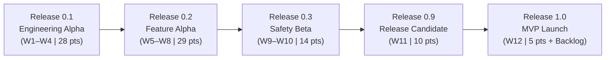
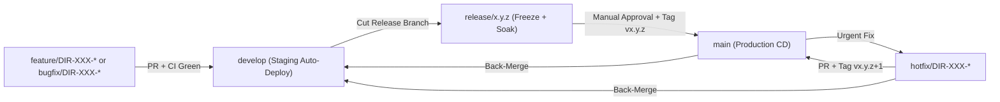

# diriddle — Release Plan & Deployment Governance

> **Scope**: All 5 GitHub Milestones (`Release 0.1 – Engineering Alpha` through `Release 1.0 – MVP`), Git branching/release workflow, and rollback/forward-fix runbooks.  
> **Milestone Definitions**: Aligned 1:1 with [`github-import/milestones.json`](./github-import/milestones.json), [`github-import/issues.csv`](./github-import/issues.csv), and [`RISK_REGISTER.md`](./RISK_REGISTER.md).

---

## 1. Release Milestones Roadmap

---

## 2. Milestone Specifications (All 5 Releases)

### Milestone 1: `Release 0.1 – Engineering Alpha` (Weeks 1–4 | Sprints 1–2)

#### 1. Scope
Establish an authentic, green engineering baseline: fail-closed JWT configuration, admin role expiration enforcement, 18+ age-gate enforcement on writes, concurrency-safe anonymous identity generation, unified `AdminRoleType` contracts, mobile API endpoint alignment, repo-wide Prettier/ESLint/LF hygiene, and a real Docker PostgreSQL + PostGIS + Redis integration test suite.

#### 2. Related `DIR-XXX` Issues (`11` issues — `28` pts)
- **Sprint 1 (14 pts)**: `DIR-001` (2), `DIR-003` (1), `DIR-004` (2), `DIR-007` (2), `DIR-030` (2), `DIR-038` (3), `DIR-041` (2)
- **Sprint 2 (14 pts)**: `DIR-002` (3), `DIR-012` (3), `DIR-013` (3), `DIR-044` (5)

#### 3. Acceptance Criteria
- API refuses to boot in production when `JWT_SECRET` or `JWT_REFRESH_SECRET` is missing or `< 32` chars (`DIR-041`).
- Expired `AdminRole.expiresAt` grants are rejected with `403 ADMIN_ROLE_EXPIRED` (`DIR-038`).
- Unverified users (`ageVerified: false`) receive `403 AGE_VERIFICATION_REQUIRED` on post, comment, reaction, and report creation (`DIR-012`), while mobile calls `/v1/auth/verify-age` and routes returning `age_verified=true` users cleanly (`DIR-007`).
- Concurrent `Anonymous #XXXX` creation in the same community never fails or duplicates `displayCode` (`DIR-013`).
- `pnpm run format:check`, `pnpm run lint` (with zero `|| echo` masks), `pnpm run typecheck`, `pnpm run build`, and real Postgres integration tests all exit `0`.

#### 4. Testing Requirements
- **Static & Unit**: `pnpm run format:check`, `pnpm run lint`, `pnpm run typecheck`, `pnpm --filter @diriddle/api test`, `pnpm --filter @diriddle/mobile test`.
- **Real Postgres/PostGIS/Redis (`DIR-044`)**: Execute `prisma migrate deploy`, `prisma/seed.ts`, and `test:pg` verifying `blocks_no_self_block`, partial unique indexes on `anonymous_identities`, and concurrent identity generation (`Promise.all` stress test).
- **Security/Privacy Verification**: Confirm unverified JWT cannot create content (`403`), expired `AdminRole` cannot hit `/v1/admin/*` (`403`), and `apps/mobile` notification read uses `PATCH /v1/notifications/:id/read`.

#### 5. Dependencies
- `DIR-003` must complete before `DIR-001` (prevent CRLF/LF churn during formatting).
- `DIR-007` precedes `DIR-012` so mobile age-verification succeeds before write guards reject unverified accounts.
- Docker Desktop / Engine available locally to run `infrastructure/docker/docker-compose.test.yml`.

#### 6. Release Checklist
- [ ] All 11 issues in Sprints 1–2 closed and linked to merged PRs on `develop`.
- [ ] `pnpm run format:check`, `pnpm run lint`, `pnpm run typecheck`, `pnpm run build` green.
- [ ] `test`, `test:e2e`, and `test:pg` pass with 0 skipped/relaxed assertions.
- [ ] Windows smoke script (`pnpm run test:windows`) verified locally across `:3000`, `:8081`, `:3001`.
- [ ] Tag `v0.1.0-alpha.1` created on `release/0.1.0` -> `main` (or internal alpha branch).

#### 7. Known Risks
- **`RISK-001`** (Hardcoded `'dev-secret'` JWT fallback) — mitigated by `DIR-041`.
- **`RISK-002`** (Expired Admin Roles Remain Active) — mitigated by `DIR-038`.
- **`RISK-004`** (18+ Age Gate Bypass on Write APIs) — mitigated by `DIR-012` & `DIR-007`.
- **`RISK-009`** (CI & Tests Run Only In-Memory) — mitigated locally by `DIR-044` (CI automation follows in `DIR-049`).
- **`RISK-014`** (Solo Developer Capacity & Context-Switching) — mitigated by strict 14-pt sprint cap.

---

### Milestone 2: `Release 0.2 – Feature Alpha` (Weeks 5–8 | Sprints 3–4)

#### 1. Scope
Productionize OTP authentication and token revocation via Supabase Auth + Redis, restore seamless mobile session refresh on 401 expiry, upgrade GitHub Actions CI to run real PostgreSQL + `format:check`, implement PostGIS + `h3-js` coarse geospatial feeds with k-anonymity (`>= 20` active users), enforce transactional post/poll writes, fix mobile category filtering, and lock down appeal ownership.

#### 2. Related `DIR-XXX` Issues (`9` issues — `29` pts)
- **Sprint 3 (14 pts)**: `DIR-008` (5), `DIR-009` (3), `DIR-010` (3), `DIR-049` (3)
- **Sprint 4 (15 pts)**: `DIR-015` (5), `DIR-016` (3), `DIR-021` (3), `DIR-027` (2), `DIR-034` (2)

#### 3. Acceptance Criteria
- `POST /v1/auth/send-otp` and `verify-otp` integrate with Supabase Auth; hardcoded `123456` fails with `401 INVALID_OTP` unless `ALLOW_DEV_OTP=true && NODE_ENV !== 'production'` (`DIR-008`).
- OTP rate-limit counters, lockouts (`429 OTP_TEMP_LOCKED`), and revoked refresh `jti`s persist in Redis across API restarts (`DIR-009`).
- Mobile client handles concurrent `401` responses with a single-flight `/v1/auth/refresh` call and clean logout on refresh failure (`DIR-010`).
- `.github/workflows/ci.yml` executes `pnpm run format:check` and real PostgreSQL/PostGIS + Redis integration tests on every PR (`DIR-049`).
- Location resolution uses `h3-js` + PostGIS `ST_DWithin` without persisting raw `lat`/`lng`, falling back to city scope whenever active users `< 20` (`DIR-015`, `DIR-016`).
- Post + Poll + PollOption + IdempotencyKey creation is atomic (`$transaction`), category chips hit `GET /v1/feed/category/:category`, and appeals validate subject ownership (`DIR-021`, `DIR-027`, `DIR-034`).

#### 4. Testing Requirements
- **Critical Privacy/Security Scenarios**:
  - Verify `123456` OTP is rejected in `NODE_ENV=production` and when `ALLOW_DEV_OTP` is unset.
  - Verify logged-out refresh token `jti` stays rejected after API restart (Redis persistence test).
  - Verify `LocationPreference` table contains zero raw coordinates (`lat`/`lng`) and `< 20` active users in an H3 cell forces city-level fallback.
  - Verify non-owner cannot submit an appeal for another user's moderated post/comment (`403`).
- **CI Pipeline**: All checks green in `.github/workflows/ci.yml` with real `postgis/postgis` and `redis` containers.

#### 5. Dependencies
- `DIR-041` -> `DIR-008`, `DIR-009`.
- `DIR-001` & `DIR-044` -> `DIR-049`.
- `DIR-044` -> `DIR-015` -> `DIR-016`.
- `DIR-013` -> `DIR-021`.
- Valid Supabase staging project credentials configured in `.env` / GitHub staging secrets.

#### 6. Release Checklist
- [ ] All 9 issues in Sprints 3–4 merged and verified in CI with real Postgres/PostGIS/Redis.
- [ ] Supabase Auth OTP flow tested end-to-end in staging environment.
- [ ] PostGIS spatial migration deployed cleanly on staging RDS/Postgres.
- [ ] `DRIFT-REGISTER.md` & `CHANGE-MATRIX.md` updated for schema/auth changes.
- [ ] Tag `v0.2.0-alpha.1` deployed to staging via `deploy-staging.yml`.

#### 7. Known Risks
- **`RISK-006`** (Mocked Auth & Dev OTP `123456`) — mitigated by `DIR-008`, `DIR-009`, and `DIR-010`.
- **`RISK-009`** (CI & Tests Run Only In-Memory) — closed by `DIR-049`.
- **`RISK-014`** (Solo Developer Capacity) — note 29 pts across Sprints 3–4 is at the ceiling; defer non-critical edge polishing if Supabase setup takes longer.

---

### Milestone 3: `Release 0.3 – Safety Beta` (Weeks 9–10 | Sprint 5)

#### 1. Scope
Deliver closed-beta Trust, Safety, and DPDP privacy compliance: complete transactional account deletion scrubbing authored posts/comments/roles/tokens, anonymous-safe author blocking from post/comment context without ever returning `author_user_id`, and live `apps/admin` integration against `/v1/admin/*` with `reporter_id` stripped and UI controls gated by RBAC role.

#### 2. Related `DIR-XXX` Issues (`4` issues — `14` pts)
- **Sprint 5 (14 pts)**: `DIR-011` (3), `DIR-033` (3), `DIR-036` (5), `DIR-037` (3)

#### 3. Acceptance Criteria
- `DELETE /v1/users/me` runs inside `$transaction`: sets `User.status=DELETED`, soft-deletes all user `Post`/`Comment` rows (`deletedAt` set, `status=REMOVED`), deletes `SavedPost`/`DeviceToken`/`AdminRole`, and revokes active tokens so subsequent API requests return `401` (`DIR-011`).
- Blocking an author from mobile post/comment detail calls server-side resolution (`target_type`, `target_id`) and immediately hides their posts/comments without any API payload exposing `author_user_id` (`DIR-033`).
- `apps/admin` authenticates via real `/v1/auth/*` OTP JWTs, maps `snake_case` API payloads to UI models cleanly, and executes real moderation actions (`POST /v1/admin/moderation/actions`, `PATCH /v1/admin/appeals/:appealId`, user/community status updates) (`DIR-036`).
- `AdminService.getReports()` strips raw `reporter_id` from standard moderator payloads, and lower Admin roles (`MODERATOR`, `ANALYST`) do not see privileged controls (`DIR-037`).

#### 4. Testing Requirements
- **Critical Diriddle Privacy & Safety Scenarios**:
  - **Zero `users.id` Leakage**: Inspect raw JSON responses of `/v1/feed/*`, `/v1/posts/*`, `/v1/posts/:id/comments`, `/v1/admin/reports` — assert `user_id`, `author_user_id`, `auth_id`, `reporter_id`, phone, and email are absent.
  - **Bidirectional Block Isolation**: After User A blocks User B via `target_type='POST'`, assert User B's posts/comments disappear from User A's feed and vice versa.
  - **DPDP Deletion Verification**: Query PostgreSQL after `DELETE /v1/users/me` to confirm 0 `PUBLISHED` posts, 0 `ACTIVE` comments, 0 `AdminRole` rows, and rejected refresh tokens.
  - **Admin RBAC Negative Test**: Assert `MODERATOR` token receives `403` on `PATCH /v1/admin/users/:id/status` and `GET /v1/admin/audit-logs`.

#### 5. Dependencies
- `DIR-009` (Redis token revocation) -> `DIR-011`.
- `DIR-004` (`AdminRoleType` alignment) -> `DIR-036` -> `DIR-037`.

#### 6. Release Checklist
- [ ] All 4 Sprint 5 issues merged and passing full CI (`format:check`, `lint`, `typecheck`, `test`, `test:e2e`, `test:pg`).
- [ ] End-to-end closed-beta moderation walkthrough executed across Mobile Web (`:8081`), API (`:3000`), and Admin Console (`:3001`).
- [ ] Staging database seeded with realistic 10-city India communities and beta test accounts.
- [ ] Tag `v0.3.0-beta.1` deployed to staging for closed-beta safety testing.

#### 7. Known Risks
- **`RISK-003`** (Reporter Identity Exposed to Moderators) — closed by `DIR-037`.
- **`RISK-005`** (Incomplete Account Deletion Scrubbing) — closed by `DIR-011`.
- **`RISK-007`** (XSS Token Exposure in Web `localStorage` — `DIR-040` deferred to Backlog) — residual risk accepted for internal Beta only with strict CSP/VPN access to Admin; prioritize `DIR-040` before wide external moderator onboarding.
- **`RISK-008`** (Author Block Broken Without Exposing `userId`) — closed by `DIR-033`.
- **`RISK-013`** (Hinglish/Regional Abuse Bypass — `DIR-039` in Backlog) — mitigated operationally in Beta via manual moderator queue monitoring.
- **`RISK-015`** (DPDP Legal & SOP Docs — `DIR-043` in Backlog) — draft Privacy Notice & Consent version check required before public app store release.

---

### Milestone 4: `Release 0.9 – Release Candidate` (Week 11 | Sprint 6 Part 1)

#### 1. Scope
Provision reproducible AWS `ap-south-1` (Mumbai) production infrastructure via Terraform, build the gated production deployment GitHub Actions workflow (`deploy-production.yml`) with Prisma migration job and automated rollback, and execute the pre-launch security & privacy penetration checklist.

#### 2. Related `DIR-XXX` Issues (`3` issues — `10` pts)
- **Sprint 6 Part 1 (10 pts)**: `DIR-051` (5), `DIR-052` (3), `DIR-053` (2)

#### 3. Acceptance Criteria
- `infrastructure/terraform/` defines VPC, private subnets, RDS PostgreSQL 16 + PostGIS, ElastiCache Redis 7, ECS Fargate + ALB/HTTPS, and encrypted S3 media bucket in `ap-south-1`; `terraform validate` and `terraform plan` succeed cleanly (`DIR-051`).
- `.github/workflows/deploy-production.yml` enforces manual environment approval, pushes immutable container tags to ECR, runs `prisma migrate deploy`, verifies `/v1/health`, and automatically rolls back ECS service on healthcheck failure (`DIR-052`).
- Pre-launch security & privacy penetration checklist passes all OWASP API Top 10, RBAC boundary, anonymity non-leakage, rate-limit, and `pnpm audit` checks (`DIR-053`).

#### 4. Testing Requirements
- `terraform fmt -check` and `terraform validate` pass in CI.
- Dry-run deployment + intentional bad-healthcheck rollback drill verified in staging ECS cluster.
- Security penetration test suite verifies: unauthenticated/unverified/expired-admin `401`/`403` rejections, cross-user post/comment delete rejection (`403`), SQL injection & validation pipe sanitization (`400`), and zero leaked secrets in repo or Docker images.

#### 5. Dependencies
- `DIR-049` (CI green) -> `DIR-051`, `DIR-052`.
- `DIR-038`, `DIR-041`, `DIR-052` -> `DIR-053`.
- AWS `ap-south-1` account, OIDC GitHub Actions IAM role, and ACM TLS certificates provisioned.

#### 6. Release Checklist
- [ ] `terraform apply` executed cleanly for production `ap-south-1` environment (state stored in encrypted S3 + DynamoDB lock).
- [ ] Production secrets stored in AWS Secrets Manager / SSM Parameter Store (zero `.env` secrets in git or images).
- [ ] `deploy-production.yml` dry-run and rollback verified.
- [ ] Signed pre-launch security & privacy checklist archived (`DIR-053`).
- [ ] Tag `v0.9.0-rc.1` promoted to staging/RC soak.

#### 7. Known Risks
- **`RISK-010`** (Zero Observability & Error Alerting — `DIR-050` in Backlog) — mitigate via CloudWatch container logs + ALB 5xx/latency alarms in `DIR-051`/`DIR-056`, and pull `DIR-050` in early post-launch.
- **`RISK-011`** (No Production IaC or CD Pipeline) — closed by `DIR-051` & `DIR-052`.
- **`RISK-012`** (Load Verification `DIR-048` in Backlog) — mitigate in RC soak via smoke concurrency checks before opening public traffic.

---

### Milestone 5: `Release 1.0 – MVP` (Week 12 | Sprint 6 Part 2)

#### 1. Scope
Verify disaster recovery readiness (automated RDS snapshots + timed PITR restore drill), build and soak-test EAS Android/iOS/Web release artifacts, publish incident response runbooks & monitoring alerts, and execute the formal `Release 1.0 – MVP` Go/No-Go sign-off. *(Note: `28` post-MVP / fast-follow backlog issues totaling `102` pts are also assigned to the `Release 1.0 – MVP` milestone bucket in GitHub for post-W12 prioritization.)*

#### 2. Related `DIR-XXX` Issues (`3` committed issues — `5` pts; plus `28` backlog issues — `102` pts)
- **Sprint 6 Part 2 (Committed, 5 pts)**: `DIR-054` (2), `DIR-055` (2), `DIR-056` (1)
- **Backlog (Post-W12 / Fast-Follow, 102 pts)**: `DIR-005`, `DIR-006`, `DIR-014`, `DIR-017`..`DIR-020`, `DIR-022`..`DIR-026`, `DIR-028`, `DIR-029`, `DIR-031`, `DIR-032`, `DIR-035`, `DIR-039`, `DIR-040`, `DIR-042`, `DIR-043`, `DIR-045`..`DIR-048`, `DIR-050`, `DIR-057`, `DIR-058`

#### 3. Acceptance Criteria
- Automated RDS daily snapshots (30-day retention) and Point-in-Time Recovery (PITR) are enabled, and a timed restore into an isolated staging RDS instance passes schema + PostGIS + data integrity checks within RTO (`DIR-054`).
- `apps/mobile/eas.json` builds valid Android AAB/APK and iOS IPA release artifacts plus Expo Web bundle; 48-hour staging soak completes with zero unhandled crashes and healthy `/v1/health` (`DIR-055`).
- Incident response runbook (covering API outage, DB recovery, PII breach/CERT-In escalation, and mass-harassment brigade response), CloudWatch alerts, and `Release 1.0` Go/No-Go checklist are signed off (`DIR-056`).

#### 4. Testing Requirements
- **DR Restore Drill**: Execute timed RDS PITR restore, run `SELECT postgis_version();` and row-count parity verification on seeded India cities/users/posts.
- **48-Hour Staging Soak**: Continuous smoke traffic against staging API + Mobile Web + Admin Console verifying zero 5xx spikes, memory leaks, or Redis disconnects.
- **Final Release Gate**: Full `pnpm run format:check`, `lint`, `typecheck`, `build`, `test`, `test:e2e`, and `test:pg` green on the release tag commit.

#### 5. Dependencies
- `DIR-051`, `DIR-052`, `DIR-053` -> `DIR-054`, `DIR-055` -> `DIR-056`.
- Apple Developer & Google Play Console accounts configured for EAS submission; DPDP Privacy Policy/Terms URLs finalized (`DIR-043` prioritized before public store submission).

#### 6. Release Checklist
- [ ] `DIR-054` RDS PITR restore drill timed and documented.
- [ ] `DIR-055` EAS Android/iOS/Web artifacts built and 48h staging soak passed.
- [ ] `DIR-056` Incident runbooks published and CloudWatch alerts verified with test notification.
- [ ] All Go/No-Go gates signed off; `release/1.0.0` merged to `main`, tagged `v1.0.0`, and back-merged to `develop`.
- [ ] Production `/v1/health`, `/docs` (disabled or gated in prod per policy), and Admin Console verified live post-cutover.

#### 7. Known Risks
- **`RISK-012`** (No Backup/Restore or Load Verification) — PITR restore closed by `DIR-054`; formal k6 load suite (`DIR-048`) scheduled immediately in post-launch Sprint 7.
- **`RISK-015`** (Indian DPDP Act & CERT-In Readiness) — incident runbook covered by `DIR-056`; full `docs/legal/` policy & SOP publishing (`DIR-043`) must precede open App Store / Play Store marketing launch.
- **`RISK-010`** (Observability Depth) — CloudWatch alerts active via `DIR-056`; Sentry/OpenTelemetry (`DIR-050`) queued as top Sprint 7 priority.

---

## 3. Git Branching & Release Workflow

### Branch Rules
1. **`main`**: Always deployable production code. Protected: requires passing CI (`format:check`, `lint`, `typecheck`, `test`, `test:e2e`, `test:pg`, `build`) and manual release approval.
2. **`develop`**: Integration branch for completed `DIR-XXX` PRs; triggers `deploy-staging.yml`.
3. **`feature/DIR-XXX-<slug>` / `bugfix/DIR-XXX-<slug>` / `chore/DIR-XXX-<slug>`**: Short-lived task branches cut from `develop`, merged via squash-merge PRs referencing `Closes #...` / `DIR-XXX`.
4. **`release/x.y.z`**: Cut from `develop` at Milestone Gates (`0.1.0`, `0.2.0`, `0.3.0`, `0.9.0`, `1.0.0`). Only stabilization fixes and version/changelog bumps enter `release/x.y.z`; once tagged on `main`, immediately back-merge `main` into `develop`.
5. **`hotfix/DIR-XXX-<slug>`**: Cut from `main` for P0 production incidents, deployed via `deploy-production.yml`, tagged `vX.Y.(Z+1)`, and back-merged into `develop`.

---

## 4. Rollback & Forward-Fix Runbook

### Decision Matrix: Rollback vs. Forward-Fix
| Scenario | Strategy | Rationale |
|---|---|---|
| **Stateless API/Admin regression (no DB schema migration)** | **Immediate ECS Rollback** | Instantaneous recovery to previous healthy immutable ECR image digest (`< 2 min`). |
| **Additive Prisma migration (new nullable column/table/index) + app bug** | **ECS Rollback (keep DB)** | Old application containers remain backward-compatible with additive schema changes. |
| **Breaking DB migration or bad data mutation** | **Forward-Fix (or RDS PITR)** | Prisma does not auto-down-migrate safely in prod; deploy an emergency hotfix migration/patch, or execute RDS PITR if data corruption occurred. |
| **Mobile client regression in EAS release** | **EAS Update / Store Halt** | Halt staged rollout in Play Console / App Store Connect and push JS OTA rollback via `eas update` (if JS-only) or expedited hotfix binary. |

### Production Rollback Procedure (`< 5` Minutes)
1. **Halt & Assess**: Confirm alert in CloudWatch / `/v1/health` (`5xx` rate `> 1%` or P95 latency `> 1000ms` for 3 consecutive minutes).
2. **Revert Traffic**: Trigger `deploy-production.yml` rollback job (or `aws ecs update-service --cluster diriddle-prod --service diriddle-api --task-definition diriddle-api:<PREVIOUS_REV>`).
3. **Verify Health**: Confirm ECS steady-state, target group healthy count, and `GET https://api.diriddle.in/v1/health` returning `200 OK`.
4. **Communicate & Document**: Record incident timeline, root cause, and follow-up `bugfix/DIR-XXX-*` issue in the Incident Log and `RISK_REGISTER.md`.
5. **Forward-Fix (when schema/data affected)**: Branch `hotfix/DIR-XXX-description` from `main`, write a failing regression test reproducing the issue, apply minimal fix + additive migration, verify in staging, and promote through `deploy-production.yml`.
